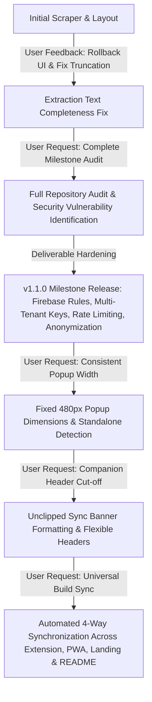
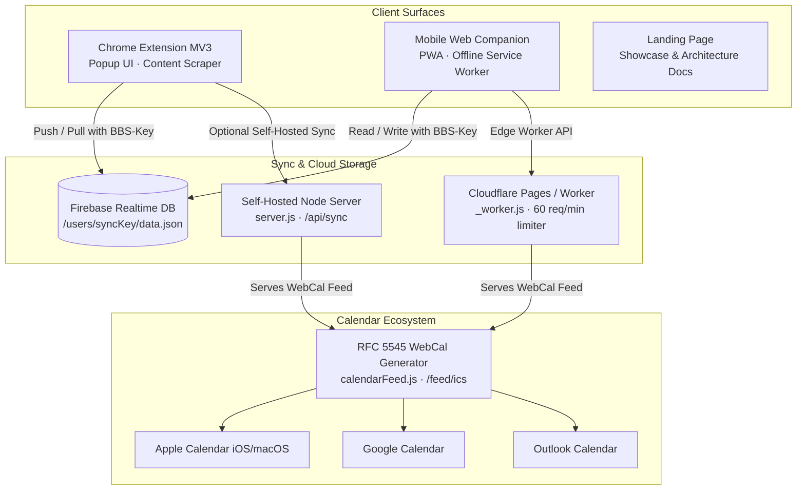
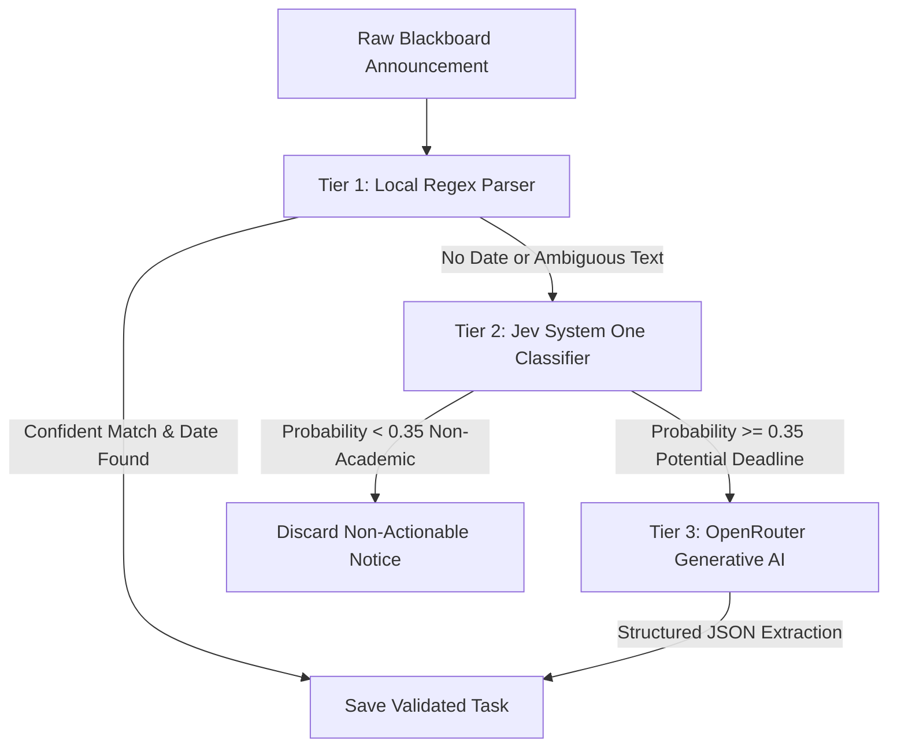
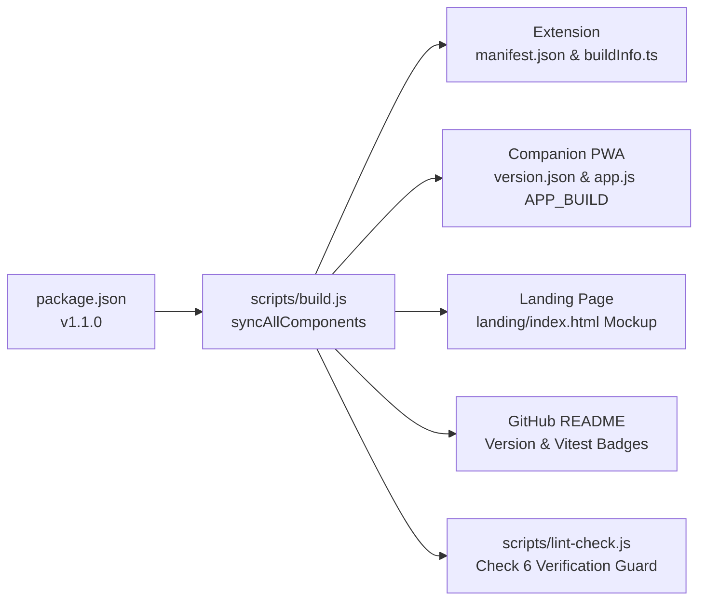

# 🧠 Blackboarder - Definitive Project & Conversation Brain

> **The Architectural Master Document, Evolutionary Memory, and Engineering Blueprint for Blackboarder.**  
> *Target Platform: University of Sharjah (UOS) & Standard Blackboard Learn / Ultra Portals.*  
> *Current Release: v1.1.0 (Milestone Release) · Repository: [yvs1n/blackboarder](https://github.com/yvs1n/blackboarder)*
>
> **This is a living document.** Read it regularly: at the start of every session, before each new task, and before changing an area it covers. Update it in the same commit as any change that makes a section stale. Log each chunk of work in [section 11](#11-progress-log). *Last updated: 2026-10-22.*

---

## 📑 Table of Contents
1. [Executive Identity & Mission](#1-executive-identity--mission)
2. [Conversation History & Evolutionary Timeline](#2-conversation-history--evolutionary-timeline)
3. [End-to-End System Architecture](#3-end-to-end-system-architecture)
4. [Security, Privacy & Multi-Tenant Data Isolation](#4-security-privacy--multi-tenant-data-isolation)
5. [The 3-Tier Intelligence & Extraction Pipeline](#5-the-3-tier-intelligence--extraction-pipeline)
6. [Design System: Swiss Grid & Two-Tone Monochrome](#6-design-system-swiss-grid--two-tone-monochrome)
7. [Universal 4-Way Build Synchronization Engine](#7-universal-4-way-build-synchronization-engine)
8. [Comprehensive Testing & Quality Assurance](#8-comprehensive-testing--quality-assurance)
9. [Complete Codebase Directory & File Blueprint](#9-complete-codebase-directory--file-blueprint)
10. [Developer Runbook & Future Maintenance Guide](#10-developer-runbook--future-maintenance-guide)
11. [Progress Log](#11-progress-log)

---

## 1. Executive Identity & Mission

### 1.1 The Problem Space
University course portals (specifically **Blackboard Learn** and **Blackboard Ultra** at `elearning.sharjah.ac.ae` and `blackboard.sharjah.ac.ae`) suffer from systemic communication fragmentation:
- Critical academic deadlines, quiz announcements, homework submissions, exam timings, and room changes are buried inside unstructured conversational text written in Arabic, English, or mixed Arabizi.
- Native Blackboard notification streams lack real-time calendar synchronization, mobile-native offline interfaces, syllabus weight impact tracking, or multi-device push capabilities.
- Students routinely miss deadlines or confuse class locations due to the friction of navigating multi-nested web pages.

### 1.2 The Solution: Blackboarder
**Blackboarder** is a full-stack, offline-first academic companion suite engineered specifically for students:
1. **Manifest V3 Chromium Extension**: Injects into Blackboard Ultra streams and course announcements, parses deadlines using hybrid local regex + AI triage, and manages tasks within a razor-sharp popup interface.
2. **Offline-First Companion PWA**: A mobile web application running locally via Service Workers, providing full calendar grids, task drawers, quick links, and grade tracking without requiring Blackboard login.
3. **Multi-Tenant Cloud Sync Engine**: Synchronizes tasks and settings seamlessly between the extension and mobile web app using isolated student sync keys (`BBS-` plus 10 random characters) across Firebase Realtime Database, a self-hosted Node.js server, and Cloudflare Pages/Workers.
4. **Live RFC 5545 WebCal Feed (`.ics`)**: Generates dynamic HTTP/HTTPS calendar subscription links compatible with Apple Calendar (iOS/macOS), Google Calendar, and Microsoft Outlook.

---

## 2. Conversation History & Evolutionary Timeline

This project evolved through rigorous iterations, continuous user feedback, code audits, bug fixes, and deliverable hardening:



### 2.1 Genesis, Layout Iterations & Text Extraction Fixes
- **Initial Feedback & Reversion**: Early visual redesigns deviated from user preferences. The user instructed to revert previous layout over-complications. Code was restored to a rock-solid foundation.
- **Announcement Text Incompleteness Bug**: During Blackboard content scraping, announcement text extraction truncated sentences abruptly due to rigid single-line regex boundaries and improper HTML element stripping.
  - *Fix*: Re-engineered `sanitizeDoctorAnnouncementText` and `scrapeAnnouncements` in `src/content/scraper.ts` to preserve multi-line paragraphs, properly unescape HTML entities, and capture full contextual instructions.

### 2.2 The Milestone Audit & Security Overhaul (v1.1.0)
The user requested a thorough audit to make the repository ready as a production milestone deliverable. Several critical gaps were identified and remediated:

| Audit Category | Identified Vulnerability / Defect | Remediation Implemented |
| :--- | :--- | :--- |
| **Sync Security** | Firebase Realtime Database permitted global root reads/writes. Anyone with the database URL could read/overwrite all student data. | Implemented `database.rules.json` enforcing strict multi-tenant path isolation (`/users/{syncKey}`). Disallowed root dumps (`.read: false`, `.write: false`). |
| **Sync Keys** | All installs defaulted to empty string or global shared key. | Added cryptographically random sync key auto-generation (`BBS-` plus random characters, 10 since 2026-10-22), isolating every student into a private namespace. |
| **Rate Limiting** | Public sync endpoints had no rate limits, allowing DoS or credential enumeration. | Implemented in-memory rate limiters (60 req/min) in `mobile-web/_worker.js` and `self-hosted/server/server.js`. Since 2026-10-22 the worker limits per IP and per key, and Vercel runs the same worker (see 4.3). |
| **Personal Privacy** | Real faculty names and proprietary syllabus PDFs were stored in the repository. | Anonymized schedules to generic `Course Faculty`, purged proprietary PDFs, and created `docs/syllabus/README.md`. |
| **Permissions** | Extension manifest requested overly broad `file:///*` matches and unnecessary `downloads` API. | Removed `file:///*` and `downloads` permissions. Replaced with standard in-tab browser downloads. |
| **Scraper Resilience** | Scraper used heavy `querySelectorAll('*')` traversals and broke on Blackboard DOM shifts. | Scoped DOM queries to `[role="feed"] *`, added Strategy 3 fallback selectors, and hardened against `Extension context invalidated` on reload. |
| **Code Hygiene** | Version was frozen at `1.0.0`, no changelog, no automated style checker. | Created `scripts/lint-check.js`, bumped project to `1.1.0`, established `CHANGELOG.md` following Keep-a-Changelog. |

### 2.3 Chronological Time Sorting for Day Items
- **User Directive**: Tasks on a specific day must always appear in chronological order (earliest time first), especially immediately after editing a task's time.
- **Fix**:
  - Implemented chronological sorting (`new Date(a.dueDate).getTime() - new Date(b.dueDate).getTime()`) across `src/popup/popup.ts` (calendar chips, day expanded drawer, selected day cards) and `mobile-web/app.js` (calendar cells, day bottom sheet, deadlines list).
  - Wired the Edit Task form submission to immediately re-sort state arrays and dynamically refresh currently open drawers.

### 2.4 Locking Extension Popup Width (480px)
- **User Directive**: Prevent the extension popup from jumping or dynamically changing width when navigating between views or loading content.
- **Root Cause**: `@media (min-height: 660px), (max-width: 470px), (min-width: 500px)` in `popup.css` triggered on high-DPI displays, stripping fixed dimensions and enabling dynamic shrink-to-fit sizing.
- **Fix**:
  - Hardcoded fixed dimensions in `src/popup/popup.css`: `width: 480px; min-width: 480px; max-width: 480px; height: 600px; min-height: 600px; max-height: 600px;`.
  - Added standalone browser tab detection in `src/popup/popup.ts` that applies `.is-standalone` when the window is wider than 520px or the URL has `standalone=1` or `view=panel`.
  - The side panel opens `src/popup/index.html?view=panel` (set in `public/manifest.json`). Side panels can be narrower than 520px, so without this flag the fixed 480px layout clipped the course chips and calendar.

### 2.5 Companion "Last Updated" Truncation Fix
- **User Directive**: Ensure the companion header text indicating when the app was last updated is never cut off with an ellipsis.
- **Fix**:
  - In `mobile-web/app.js`: Formatted update string to `Updated ${dateStr}, ${timeStr} · ${countStr}`.
  - In `mobile-web/styles.css`: Set `#sync-banner-text` to `white-space: normal; line-height: 1.25; word-break: break-word; overflow: visible;`.
  - Cleaned accidental duplicate `flex: 1` declarations and ensured `.header-brand` and `.brand-text` flex properly.

### 2.6 Universal 4-Way Build Synchronization
- **User Directive**: Ensure that whenever updates are made in the future, everything stays synchronized across the extension, companion PWA, landing page, and GitHub README.
- **Fix**:
  - Engineered `syncAllComponents()` in `scripts/build.js` to automatically propagate the current version and test counts across all 4 surfaces on every build.
  - Added Check #6 in `scripts/lint-check.js` to fail CI if any component experiences version drift.

---

## 3. End-to-End System Architecture



### 3.1 Chrome Extension Architecture (Manifest V3)
- **Popup UI (`src/popup/`)**:
  - Built with pure TypeScript, Swiss Grid CSS, and zero UI frameworks for near-zero startup latency.
  - Tabs: Monthly Calendar, Deadlines List, Quick Links, Grade Tracker, and Settings.
  - Features real-time search, filters (All, Quizzes, Assignments, Exams), manual task creation, editing modals, JSON backup/restore, and GitHub auto-update checks.
- **Content Scripts (`src/content/`)**:
  - `scraper.ts`: Scrapes announcements and Ultra stream timelines from Blackboard portals. Injects the floating "Scan Blackboard" pill button. Includes defensive context invalidation checks.
  - `blackboard-dark.js` & `blackboard-dark.css`: Built-in dark mode injector that styles native Blackboard Learn pages to prevent student eye strain.
- **Background Service Worker (`src/background/`)**:
  - `serviceWorker.ts`: Handles extension alarms (midnight sync, hourly GitHub update checks), badge counts (`updateBadge`), CORS-bypassing API requests for Jev/OpenRouter, and context messaging.
  - `autoUpdate.ts`: Automatically polls GitHub repository releases and downloads updated assets into `dist/`.

### 3.2 Mobile Web Companion PWA (`mobile-web/`)
- Fully responsive progressive web app designed for mobile Safari (iOS) and mobile Chrome (Android).
- **Offline Resilience (`sw.js`)**: Caches all UI assets (`core.js`, `styles.css`, icons, webmanifest) using cache-first strategies with dynamic `?v=buildId` cache busting.
- **Feature Parity**: Provides full calendar grid, day drawer sheets, deadline lists, syllabus progress, custom room editors, and live sync pairing with the desktop extension.

### 3.3 Live RFC 5545 WebCal Calendar Feed
- Implemented in `mobile-web/_worker.js` and bundled into `self-hosted/server/calendarFeed.js`.
- Generates standards-compliant `.ics` calendar files with:
  - Unique UID hashes based on task ID and title.
  - Proper UTC timestamps (`DTSTART`, `DTEND`, `DTSTAMP`).
  - Formatted descriptions containing announcement text, syllabus weight, and room locations.
  - Automatic `webcal://` URL generation for one-tap calendar subscription on iPhone and Mac.

---

## 4. Security, Privacy & Multi-Tenant Data Isolation

### 4.1 Multi-Tenant Firebase Realtime Database Rules
In `database.rules.json`, public root access is forbidden. Every student's data lives at `users/{syncKey}/data`, the path all clients write:

```json
{
  "rules": {
    ".read": false,
    ".write": false,
    "users": {
      "$syncKey": {
        ".read": "$syncKey.length >= 8 && $syncKey.length <= 64 && $syncKey.matches(/^[A-Za-z0-9_-]+$/)",
        ".write": "$syncKey.length >= 8 && $syncKey.length <= 64 && $syncKey.matches(/^[A-Za-z0-9_-]+$/)",
        "data": { ".validate": "newData.hasChild('tasks')" },
        "$other": { ".validate": false }
      }
    }
  }
}
```
- An earlier version put `.validate` on `users/{syncKey}` itself and asked for a `tasks` child there. Clients write one level deeper (`.../data`), so that rule would have rejected every sync.
- **The file only takes effect once it is published** in the Firebase console (Realtime Database > Rules). Check the live rules match this file after any change.
- The legacy shared bucket at the root (`/data.json`) is now closed to clients by these rules.

### 4.2 Automatic Sync Key Provisioning
`generateUniqueSyncKey()` in `src/utils/storage.ts` makes `BBS-` plus 10 characters from `ABCDEFGHJKLMNPQRSTUVWXYZ23456789`. The alphabet has 32 symbols, so each random byte maps without bias, giving 50 bits of randomness. Keys from older builds (6 characters, e.g. `BBS-AB12CD`) stay valid because the rules and the worker accept any key of 8 to 64 characters from `A-Z a-z 0-9 _ -`.

Students pair devices by scanning a QR code or entering their personal key into the Companion PWA settings.

### 4.3 Backend Request Rules (`mobile-web/_worker.js`)
`mobile-web/_worker.js` is the single backend for Cloudflare Pages, the standalone Cloudflare Worker, and Vercel (through `api/[...path].js`).
- **A sync key is required.** `/api/tasks`, `/api/sync`, `/api/task-status` and `/feed.ics` return `400` without a valid key (`cleanSyncKey()`, same pattern as the Firebase rules). Nothing falls back to a shared default bucket.
- `/api/status` reports `paired: true/false` and only reads data when a key is given.
- **Rate limiting:** an in-memory fixed one-minute window per worker instance. It limits each IP and each key separately (`isRateLimited()`), so guessing many keys from one IP does not help. Defaults are 60 requests per minute, 120 for `/api/tasks` and 20 for the AI routes. The calendar feed is limited per key only, because calendar services fetch from shared IPs. Over the limit returns `429`. Because the limit lives in one instance it slows abuse but does not stop it; add a Cloudflare rate limiting rule for hard limits.
- **AI keys:** the server's own `JEV_API_KEY` / `OPENROUTER_API_KEY` are only used for requests that carry a sync key; otherwise the caller must supply their own `apiKey`.
- The self-hosted LAN server (`self-hosted/server/server.js`) still accepts requests without a key. That is acceptable for single-user local use only.

---

## 5. The 3-Tier Intelligence & Extraction Pipeline

Blackboarder uses a cascaded triage architecture to maximize extraction accuracy while minimizing API costs and latency:



### 5.1 Tier 1: Local Deterministic Parser (`src/engine/localExtractor.ts`)
- Zero network latency, executed client-side.
- Evaluates bilingual regex patterns for Arabic (كويز, واجب, امتحان, تسليم) and English (quiz, assignment, midterm, deadline).
- Normalizes relative dates ("next Monday", "الأحد القادم", "before midnight") and matches against the student's registered class schedule.

### 5.2 Tier 2: Jev System One Fast Classifier (`src/engine/jevClassifier.ts`)
- Serves as an ultra-low-latency gatekeeper using the TypeSafe AI SDK.
- Classifies incoming text into academic categories (`quiz`, `assignment`, `exam`, `general_announcement`) and generates an urgency score (0.0 to 5.0).
- Prevents expensive LLM API invocations on conversational notices (e.g., "Welcome to the semester", "Doctor is absent today").

### 5.3 Tier 3: OpenRouter Generative AI Deep Parser (`src/engine/aiExtractor.ts`)
- Invoked only for confirmed deadlines with complex or ambiguous wording.
- Employs structured system prompts requiring output conforming to the strict `ExtractedTask` TypeScript schema.

---

## 6. Design System: Swiss Grid & Two-Tone Monochrome

Blackboarder follows the **Swiss Style (International Typographic Style)** to provide maximum visual clarity, utility, and speed.

### 6.1 Universal 0px Border Radius
To prevent modern generic "AI slop" interfaces characterized by exaggerated rounded pills and excessive gradients, universal razor-sharp corners are enforced:
```css
*, *::before, *::after {
  border-radius: 0 !important;
}
```

### 6.2 Flat Two-Tone Palette
All neon greens (`#10b981`, `#34d399`) were replaced with neutral monochrome tokens:
- **Light Theme**: Surface `#ffffff`, Text `#18181b`, Muted `#71717a`, Border `#e4e4e7`, Highlight `#f4f4f5`.
- **Dark Theme**: Surface `#18181b`, Text `#f4f4f6`, Muted `#a1a1aa`, Border `#27272a`, Highlight `#242427`.
- **Accent**: Deliberate, single-accent blue (`#2563eb` light / `#3b82f6` dark) used exclusively for active navigation or verified status.

### 6.3 Typography & Punctuation Rules
- Universal font stack: Inter, -apple-system, BlinkMacSystemFont, "Segoe UI", Roboto, sans-serif.
- **Strict Prohibition of Em-Dashes**: Em-dashes (`—` / `\u2014`) are strictly banned across all UI text, labels, documentation, and code comments in favor of standard hyphens (`-`).

---

## 7. Universal 4-Way Build Synchronization Engine

Whenever updates are made to the codebase, the universal synchronization engine built into `scripts/build.js` guarantees that every project surface remains in lockstep:



### 7.1 Automated Actions on Every Build (`npm run build`)
1. Reads the canonical version from `package.json`.
2. Inspects `tests/` and dynamically counts passing test cases (329 tests across 35 suites).
3. Updates `public/manifest.json` and `dist/manifest.json`.
4. Updates `src/buildInfo.ts` with source file SHA256 hashes, git commit, and timestamp.
5. Updates `landing/index.html` mockup header: `<span>Blackboarder v${version}</span>`.
6. Updates `README.md` Version badge (`badge/Version-v${version}-blue`) and Vitest badge (`badge/Tests-${count}_Passing-success`).
7. Stamps `mobile-web/app.js` (`const APP_BUILD = {...}`), `mobile-web/sw.js` (`const BUILD_ID = '...'`), and `mobile-web/version.json`.
8. Recompiles all bundles via Vite and bundles the standalone Cloudflare Worker.

### 7.2 The Lint & Hygiene Guard (`scripts/lint-check.js`)
Executed via `npm run lint` and `npm run check`. It executes 6 critical checks:
1. **TypeScript Compilation**: `tsc --noEmit` across entire repository.
2. **Swiss Grid Compliance**: Verifies `border-radius: 0 !important;` in `popup.css` and `styles.css`.
3. **Two-Tone Compliance**: Verifies zero prohibited neon green hex codes.
4. **JSON File Integrity**: Validates syntax of `package.json`, `manifest.json`, and `database.rules.json`.
5. **Typography Check**: Scans docs for prohibited em-dashes (`—`).
6. **Universal Synchronization Check**: Asserts that `package.json`, `public/manifest.json`, `landing/index.html`, `README.md`, `dist/version.json`, and `mobile-web/version.json` match identically.

---

## 8. Comprehensive Testing & Quality Assurance

Blackboarder is covered by **35 test files comprising 329 automated tests** running on Vitest:

| Test Suite File | Test Count | Scope of Verification |
| :--- | :---: | :--- |
| `tests/syncSecurity.test.ts` | 7 | Key-required API routes (400), per-IP rate limiting, AI key lending, Firebase rules shape, and the Vercel adapter. |
| `tests/syncKeyIsolation.test.ts` | 11 | Multi-tenant Firebase namespace isolation and unauthorized path rejection. |
| `tests/serverIntegration.test.ts` | 6 | Live HTTP sync bridge, rate limiter sliding window, and 429 status codes. |
| `tests/pagesWorker.test.ts` | 6 | Cloudflare Pages edge worker, rate limiting, and ICS feed routes. |
| `tests/extensionContext.test.ts` | 15 | Manifest V3 context invalidation resilience and graceful tab reload notifications. |
| `tests/popupUI.test.ts` | 5 | Screen reader accessibility (`aria-label`, `role`), keyboard controls, and DOM bounds. |
| `tests/realScraperDOM.test.ts` | 7 | Ultra stream scraping across real-world Blackboard HTML mocks and custom tags. |
| `tests/stressTesting.test.ts` | 11 | Performance under load (1,000+ deadlines sorted and filtered in < 50ms). |
| `tests/syllabusWeights.test.ts` | 28 | Syllabus component matching, grading formulas, and weight backfilling. |
| `tests/calendar.test.ts` | 18 | Monthly grid math, leap years, timezone adjustments, and drawer views. |
| `tests/calendarFeed.test.ts` | 9 | RFC 5545 iCalendar serialization, UID uniqueness, and escaping rules. |
| `tests/bidirectionalSync.test.ts` | 10 | Timestamp conflict resolution (`updatedAt`), field merging, and note retention. |
| `tests/mobileSorting.test.ts` | 4 | Chronological time sorting (earliest first) and immediate re-sort on time edit. |
| `tests/generatedFiles.test.ts` | 4 | Verifies built bundles match sources byte-for-byte. |
| *Other 21 Test Suites* | 188 | Regex extraction, course colors, schedule slots, dark mode CSS, updater logic. |
| **Total** | **329** | **100% Passing** |

---

## 9. Complete Codebase Directory & File Blueprint

```
blackboard_sidekick/
├── .github/
│   └── workflows/build.yml           # CI/CD: Automated build, test, and sync verification
├── api/
│   └── [...path].js                  # Vercel adapter: runs mobile-web/_worker.js for /api/* and the feed
├── assets/                           # Branding assets and logo
├── dist/                             # Compiled Chrome Extension MV3 (Load Unpacked)
│   ├── background.js                 # Service worker bundle
│   ├── content.js                    # Blackboard content scraper bundle
│   ├── manifest.json                 # Extension manifest (v1.1.0)
│   ├── version.json                  # Extension build metadata and file hashes
│   └── src/popup/                    # Compiled popup HTML and assets
├── docs/                             # Documentation suite
│   ├── HOSTING_GUIDE.md              # Cloudflare Pages, Vercel, and Node hosting instructions
│   ├── INSTALL_EXTENSION.md          # 60-second Chrome extension installation guide
│   ├── WALKTHROUGH.md                # Feature walkthrough and user guide
│   └── syllabus/README.md            # Privacy syllabus guide
├── landing/                          # Standalone product landing page
│   └── index.html                    # Responsive Swiss Grid landing page and live mockup
├── mobile-web/                       # Mobile Web Companion PWA
│   ├── app.js                        # PWA state machine, views, calendar, and sync
│   ├── core.js                       # Bundled shared core logic (from src/mobile/core.ts)
│   ├── index.html                    # PWA application shell
│   ├── styles.css                    # PWA Swiss Grid CSS (0px border-radius, two-tone)
│   ├── sw.js                         # Offline cache-first Service Worker
│   ├── version.json                  # PWA build metadata and hash
│   ├── widget.js                     # Scriptable iOS widget script
│   └── _worker.js                    # Cloudflare Pages worker (sync API + ICS feed)
├── public/                           # Static assets copied into dist/
│   ├── icons/                        # 16px, 32px, 48px, 128px icons
│   └── manifest.json                 # Source Chromium Manifest V3
├── release/                          # Packaged release archives (from npm run package)
│   ├── blackboarder-extension.zip    # Unpacked zip for students
│   ├── blackboarder-website.zip      # Web app zip for hosting
│   └── blackboarder-full-product.zip # Full product distribution
├── scripts/                          # Engineering & build pipeline scripts
│   ├── build.js                      # Universal compiler and 4-way synchronization
│   ├── bundle-worker.js              # Bundles Cloudflare Worker & Node calendar feed
│   ├── lint-check.js                 # Repository style, hygiene, and sync validator
│   └── package.js                    # Production release packager and zip compressor
├── self-hosted/                      # Standalone hosting engines
│   ├── cloudflare-worker/worker.js   # Single-file standalone Cloudflare Worker
│   └── server/                       # Standalone Node.js Express server
│       ├── calendarFeed.js           # RFC 5545 feed generator
│       └── server.js                 # Local sync and feed HTTP server
├── src/                              # Chrome Extension Source Code
│   ├── background/                   # Background service workers and update checkers
│   ├── content/                      # Scrapers, dark mode, and DOM observers
│   ├── core/                         # Course colors, schedules, and syllabus weights
│   ├── engine/                       # Hybrid regex, Jev gatekeeper, and AI extractor
│   ├── popup/                        # Extension popup UI (index.html, popup.ts, popup.css)
│   ├── utils/                        # Storage, Firebase sync, and context guards
│   └── buildInfo.ts                  # Auto-generated build stamp (hash, commit, version)
├── tests/                            # 35 Vitest test suites (329 tests)
├── widgets/                          # Scriptable iOS widget source
├── CHANGELOG.md                      # Keep-a-Changelog revision history
├── database.rules.json               # Firebase Realtime Database multi-tenant security rules
├── package.json                      # Project dependencies, scripts, and version (v1.1.0)
├── CLAUDE.md                         # Loads this file into every Claude Code session
├── PROJECT_BRAIN.md                  # This master knowledge-base document
└── README.md                         # Public GitHub README with live badges
```

---

## 10. Developer Runbook & Future Maintenance Guide

### 10.1 Key Terminal Commands
```powershell
# Development: Compile extension and companion app
npm run dev

# Production Build: Automatically synchronizes all 4 components and compiles assets
npm run build

# Lint & Hygiene: Validates TypeScript, Swiss 0px, Two-Tone colors, typography, and version sync
npm run lint

# Testing: Runs all Vitest test suites
npm test

# Release Packaging: Builds extension, runs tests, and packages release zips
npm run release

# Start Local Server: Launches local sync server on http://localhost:3456
npm run server
```

### 10.2 How to Bump Versions in the Future
Thanks to the universal synchronization engine, bumping a version requires editing only **one single line**:
1. Open `package.json` and change `"version": "1.2.0"`.
2. Run `npm run build`.
3. The build script automatically updates:
   - `public/manifest.json` (`"version": "1.2.0"`)
   - `landing/index.html` (`Blackboarder v1.2.0`)
   - `README.md` (`Version-v1.2.0` badge and latest test count)
   - `src/popup/index.html` static version tags
   - `src/buildInfo.ts`
   - `mobile-web/version.json` and `dist/version.json`
4. Run `npm run lint` to verify that all components are in lockstep.
5. Add changes to `CHANGELOG.md` under `## [1.2.0]`.
6. Commit and push: `git commit -am "chore: release v1.2.0"` and `git push origin main`.

### 10.3 Inviolable Project Invariants
For any human or AI assistant continuing work on Blackboarder:
1. **Never Reintroduce Rounded Corners**: Universal `border-radius: 0 !important;` is mandatory.
2. **Never Reintroduce Prohibited Neon Greens**: Stick to clean monochrome neutral tokens.
3. **Never Use Em-Dashes (`—`)**: Always use standard hyphens (`-`).
4. **Never Break Multi-Tenant Isolation**: Never write to root `/` in Firebase; always scope reads and writes to `/users/{syncKey}`.
5. **Always Run `npm run lint` and `npm test` Before Committing**: Ensure every test suite passes 100%.
6. **Read and Keep This File Current**: Read it at the start of every session and before each task. Any change that makes a section here stale updates that section in the same commit, and each chunk of work gets an entry in section 11.

---

## 11. Progress Log

Newest first. Each entry says what changed, what is still open, and anything only the project owner can do.

### 2026-10-22 - Sync security hardening and v1.1.0 follow-up (uncommitted)
Reviewed the v1.1.0 commits against the seven audit areas (sync security, personal data, permissions, scraper robustness, popup logic and a11y, project hygiene, test gaps). Most were covered; these gaps were fixed:
- **Firebase rules** rewritten so they match the real data path `users/{key}/data` (see 4.1).
- **Worker** requires a valid sync key on every data route, limits per IP and per key, and only lends server AI keys to paired devices (see 4.3).
- **Vercel**: the old `api/feed.js`, `api/status.js`, `api/sync.js` and `api/tasks.js` were removed. They read without a key, used a broken `server/data` path, fell back to sample data, and wiped quick links and tombstones. `api/[...path].js` now runs the shared worker.
- **Side panel** opens with `?view=panel` so it gets the full-width layout instead of clipping.
- **Sync keys** are now 10 random characters; old keys keep working.
- **Tests**: existing worker tests now send a key; new `tests/syncSecurity.test.ts` (7 tests).

Still open:
- Re-inject `content.js` / `content.css` into open Blackboard tabs after an extension update, and give the floating button an instance id so a stale copy cannot relabel the fresh one (`src/background/serviceWorker.ts`, `src/content/scraper.ts`).
- CHANGELOG, HOSTING_GUIDE and README updates; full build, lint, test; commit and push.

Owner actions:
- Publish `database.rules.json` in the Firebase console.
- Calendar links without `?key=` stop working; re-copy the calendar link from the app.
- Optionally delete the old shared `/data.json` bucket in Firebase.

---

*Document compiled and verified for Blackboarder v1.1.0.*
