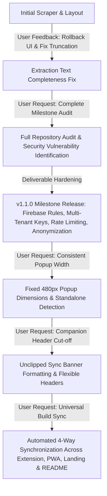
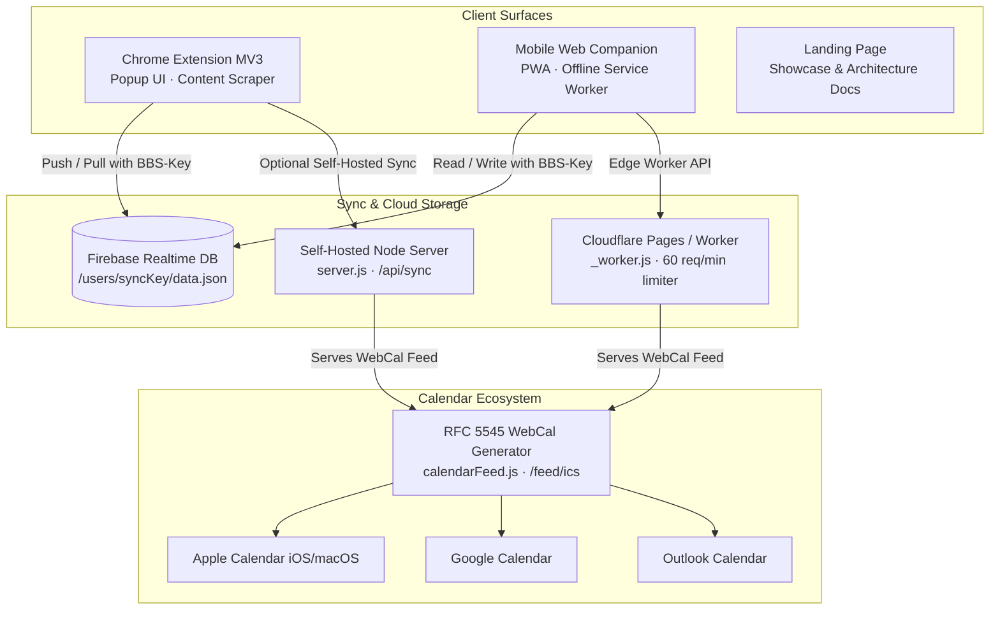
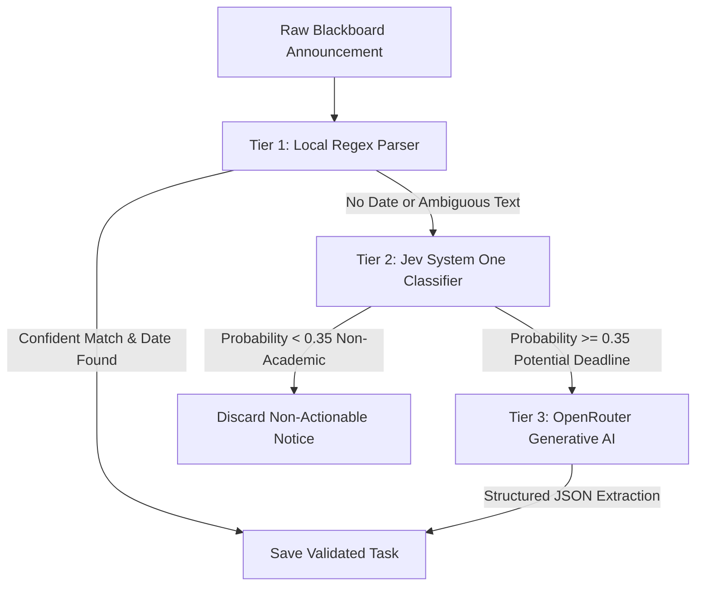
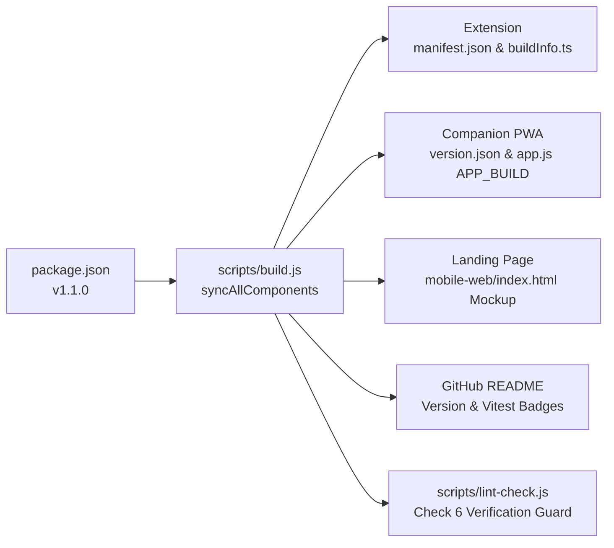

# 🧠 Blackboarder - Definitive Project & Conversation Brain

> **The Architectural Master Document, Evolutionary Memory, and Engineering Blueprint for Blackboarder.**  
> *Target Platform: University of Sharjah (UOS) & Standard Blackboard Learn / Ultra Portals.*  
> *Current Release: v1.1.0 (Milestone Release) · Repository: [yvs1n/blackboarder](https://github.com/yvs1n/blackboarder)*
>
> **This is a living document.** Read it regularly: at the start of every session, before each new task, and before changing an area it covers. Update it in the same commit as any change that makes a section stale. Log each chunk of work in [section 11](#11-progress-log). *Last updated: 2026-10-22.*

---

## 📑 Table of Contents
1. [Executive Identity & Mission](#1-executive-identity--mission)
2. [Conversation History & Evolutionary Timeline](#2-conversation-history--evolutionary-timeline)
3. [End-to-End System Architecture](#3-end-to-end-system-architecture)
4. [Security, Privacy & Multi-Tenant Data Isolation](#4-security-privacy--multi-tenant-data-isolation)
5. [The 3-Tier Intelligence & Extraction Pipeline](#5-the-3-tier-intelligence--extraction-pipeline)
6. [Design System: Swiss Grid & Two-Tone Monochrome](#6-design-system-swiss-grid--two-tone-monochrome)
7. [Universal 4-Way Build Synchronization Engine](#7-universal-4-way-build-synchronization-engine)
8. [Comprehensive Testing & Quality Assurance](#8-comprehensive-testing--quality-assurance)
9. [Complete Codebase Directory & File Blueprint](#9-complete-codebase-directory--file-blueprint)
10. [Developer Runbook & Future Maintenance Guide](#10-developer-runbook--future-maintenance-guide)
11. [Progress Log](#11-progress-log)

---

## 1. Executive Identity & Mission

### 1.1 The Problem Space
University course portals (specifically **Blackboard Learn** and **Blackboard Ultra** at `elearning.sharjah.ac.ae` and `blackboard.sharjah.ac.ae`) suffer from systemic communication fragmentation:
- Critical academic deadlines, quiz announcements, homework submissions, exam timings, and room changes are buried inside unstructured conversational text written in Arabic, English, or mixed Arabizi.
- Native Blackboard notification streams lack real-time calendar synchronization, mobile-native offline interfaces, syllabus weight impact tracking, or multi-device push capabilities.
- Students routinely miss deadlines or confuse class locations due to the friction of navigating multi-nested web pages.

### 1.2 The Solution: Blackboarder
**Blackboarder** is a full-stack, offline-first academic companion suite engineered specifically for students:
1. **Manifest V3 Chromium Extension**: Injects into Blackboard Ultra streams and course announcements, parses deadlines using hybrid local regex + AI triage, and manages tasks within a razor-sharp popup interface.
2. **Offline-First Companion PWA**: A mobile web application running locally via Service Workers, providing full calendar grids, task drawers, quick links, and grade tracking without requiring Blackboard login.
3. **Multi-Tenant Cloud Sync Engine**: Synchronizes tasks and settings seamlessly between the extension and mobile web app using isolated student sync keys (`BBS-` plus 10 random characters) across Firebase Realtime Database, a self-hosted Node.js server, and Cloudflare Pages/Workers.
4. **Live RFC 5545 WebCal Feed (`.ics`)**: Generates dynamic HTTP/HTTPS calendar subscription links compatible with Apple Calendar (iOS/macOS), Google Calendar, and Microsoft Outlook.

---

## 2. Conversation History & Evolutionary Timeline

This project evolved through rigorous iterations, continuous user feedback, code audits, bug fixes, and deliverable hardening:



### 2.1 Genesis, Layout Iterations & Text Extraction Fixes
- **Initial Feedback & Reversion**: Early visual redesigns deviated from user preferences. The user instructed to revert previous layout over-complications. Code was restored to a rock-solid foundation.
- **Announcement Text Incompleteness Bug**: During Blackboard content scraping, announcement text extraction truncated sentences abruptly due to rigid single-line regex boundaries and improper HTML element stripping.
  - *Fix*: Re-engineered `sanitizeDoctorAnnouncementText` and `scrapeAnnouncements` in `src/content/scraper.ts` to preserve multi-line paragraphs, properly unescape HTML entities, and capture full contextual instructions.

### 2.2 The Milestone Audit & Security Overhaul (v1.1.0)
The user requested a thorough audit to make the repository ready as a production milestone deliverable. Several critical gaps were identified and remediated:

| Audit Category | Identified Vulnerability / Defect | Remediation Implemented |
| :--- | :--- | :--- |
| **Sync Security** | Firebase Realtime Database permitted global root reads/writes. Anyone with the database URL could read/overwrite all student data. | Implemented `database.rules.json` enforcing strict multi-tenant path isolation (`/users/{syncKey}`). Disallowed root dumps (`.read: false`, `.write: false`). |
| **Sync Keys** | All installs defaulted to empty string or global shared key. | Added cryptographically random sync key auto-generation (`BBS-` plus random characters, 10 since 2026-10-22), isolating every student into a private namespace. |
| **Rate Limiting** | Public sync endpoints had no rate limits, allowing DoS or credential enumeration. | Implemented in-memory rate limiters (60 req/min) in `mobile-web/_worker.js` and `self-hosted/server/server.js`. Since 2026-10-22 the worker limits per IP and per key, and Vercel runs the same worker (see 4.3). |
| **Personal Privacy** | Real faculty names and proprietary syllabus PDFs were stored in the repository. | Anonymized schedules to generic `Course Faculty`, purged proprietary PDFs, and created `docs/syllabus/README.md`. |
| **Permissions** | Extension manifest requested overly broad `file:///*` matches and unnecessary `downloads` API. | Removed `file:///*` and `downloads` permissions. Replaced with standard in-tab browser downloads. |
| **Scraper Resilience** | Scraper used heavy `querySelectorAll('*')` traversals and broke on Blackboard DOM shifts. | Scoped DOM queries to `[role="feed"] *`, added Strategy 3 fallback selectors, and hardened against `Extension context invalidated` on reload. |
| **Code Hygiene** | Version was frozen at `1.0.0`, no changelog, no automated style checker. | Created `scripts/lint-check.js`, bumped project to `1.1.0`, established `CHANGELOG.md` following Keep-a-Changelog. |

### 2.3 Chronological Time Sorting for Day Items
- **User Directive**: Tasks on a specific day must always appear in chronological order (earliest time first), especially immediately after editing a task's time.
- **Fix**:
  - Implemented chronological sorting (`new Date(a.dueDate).getTime() - new Date(b.dueDate).getTime()`) across `src/popup/popup.ts` (calendar chips, day expanded drawer, selected day cards) and `mobile-web/app.js` (calendar cells, day bottom sheet, deadlines list).
  - Wired the Edit Task form submission to immediately re-sort state arrays and dynamically refresh currently open drawers.

### 2.4 Locking Extension Popup Width (480px)
- **User Directive**: Prevent the extension popup from jumping or dynamically changing width when navigating between views or loading content.
- **Root Cause**: `@media (min-height: 660px), (max-width: 470px), (min-width: 500px)` in `popup.css` triggered on high-DPI displays, stripping fixed dimensions and enabling dynamic shrink-to-fit sizing.
- **Fix**:
  - Hardcoded fixed dimensions in `src/popup/popup.css`: `width: 480px; min-width: 480px; max-width: 480px; height: 600px; min-height: 600px; max-height: 600px;`.
  - `isToolbarPopup()` in `src/popup/popup.ts` applies `.is-standalone` to everything except the toolbar popup (asked via `chrome.extension.getViews({ type: 'popup' })`), plus URLs with `standalone=1` or `view=panel`.
  - The side panel opens `src/popup/index.html?view=panel` (set in `public/manifest.json`). Side panels can be narrower than 520px, so without this flag the fixed 480px layout clipped the course chips and calendar.

### 2.5 Companion "Last Updated" Truncation Fix
- **User Directive**: Ensure the companion header text indicating when the app was last updated is never cut off with an ellipsis.
- **Fix**:
  - In `mobile-web/app.js`: Formatted update string to `Updated ${dateStr}, ${timeStr} · ${countStr}`.
  - In `mobile-web/styles.css`: Set `#sync-banner-text` to `white-space: normal; line-height: 1.25; word-break: break-word; overflow: visible;`.
  - Cleaned accidental duplicate `flex: 1` declarations and ensured `.header-brand` and `.brand-text` flex properly.

### 2.6 Universal 4-Way Build Synchronization
- **User Directive**: Ensure that whenever updates are made in the future, everything stays synchronized across the extension, companion PWA, landing page, and GitHub README.
- **Fix**:
  - Engineered `syncAllComponents()` in `scripts/build.js` to automatically propagate the current version and test counts across all 4 surfaces on every build.
  - Added Check #6 in `scripts/lint-check.js` to fail CI if any component experiences version drift.

---

## 3. End-to-End System Architecture



### 3.1 Chrome Extension Architecture (Manifest V3)
- **Popup UI (`src/popup/`)**:
  - Built with pure TypeScript, Swiss Grid CSS, and zero UI frameworks for near-zero startup latency.
  - Tabs: Monthly Calendar, Deadlines List, Quick Links, Grade Tracker, and Settings.
  - Features real-time search, filters (All, Quizzes, Assignments, Exams), manual task creation, editing modals, JSON backup/restore, and GitHub auto-update checks.
  - **Scanning does not run in the popup.** The Scan button sends `TRIGGER_SCAN` to the Blackboard tab, which runs `runScan()` and saves the result; the popup only shows `bbs_scan_status` (`ScanStatus` in `src/utils/storage.ts`), on open and on change. Closing the popup no longer cancels a scan.
- **Content Scripts (`src/content/`)**:
  - `scraper.ts`: Scrapes announcements and Ultra stream timelines from Blackboard portals. Injects the floating "Scan Blackboard" pill button. Includes defensive context invalidation checks.
  - `blackboard-dark.js` & `blackboard-dark.css`: Built-in dark mode injector that styles native Blackboard Learn pages to prevent student eye strain.
- **Background Service Worker (`src/background/`)**:
  - `serviceWorker.ts`: Handles extension alarms (midnight sync, hourly GitHub update checks), badge counts (`updateBadge`), CORS-bypassing API requests for Jev/OpenRouter, and context messaging.
  - `autoUpdate.ts`: Automatically polls GitHub repository releases and downloads updated assets into `dist/`.

### 3.2 Mobile Web Companion PWA (`mobile-web/companion/`, served at `/companion/`)
- `mobile-web/` is the whole site: the landing page (`index.html`) at `/`, the companion at `/companion/`, and `_worker.js`. The worker redirects `/?key=...` to `/companion/`; the landing page also forwards installed (standalone) launches. `mobile-web/sw.js` retires the service worker the app registered at the root before the move.
- Fully responsive progressive web app designed for mobile Safari (iOS) and mobile Chrome (Android).
- **Offline Resilience (`sw.js`)**: Caches all UI assets (`core.js`, `styles.css`, icons, webmanifest) using cache-first strategies with dynamic `?v=buildId` cache busting.
- **Feature Parity**: Provides full calendar grid, day drawer sheets, deadline lists, syllabus progress, custom room editors, and live sync pairing with the desktop extension.

### 3.3 Live RFC 5545 WebCal Calendar Feed
- Implemented in `mobile-web/_worker.js` and bundled into `self-hosted/server/calendarFeed.js`.
- Generates standards-compliant `.ics` calendar files with:
  - Unique UID hashes based on task ID and title.
  - Proper UTC timestamps (`DTSTART`, `DTEND`, `DTSTAMP`).
  - Formatted descriptions containing announcement text, syllabus weight, and room locations.
  - Automatic `webcal://` URL generation for one-tap calendar subscription on iPhone and Mac.

---

## 4. Security, Privacy & Multi-Tenant Data Isolation

### 4.1 Multi-Tenant Firebase Realtime Database Rules
In `database.rules.json`, public root access is forbidden. Every student's data lives at `users/{syncKey}/data`, the path all clients write:

```json
{
  "rules": {
    ".read": false,
    ".write": false,
    "users": {
      "$syncKey": {
        ".read": "$syncKey.length >= 8 && $syncKey.length <= 64 && $syncKey.matches(/^[A-Za-z0-9_-]+$/)",
        ".write": "$syncKey.length >= 8 && $syncKey.length <= 64 && $syncKey.matches(/^[A-Za-z0-9_-]+$/)",
        "data": { ".validate": "newData.hasChild('lastSync')" },
        "$other": { ".validate": false }
      }
    }
  }
}
```
- An earlier version put `.validate` on `users/{syncKey}` itself and asked for a `tasks` child there. Clients write one level deeper (`.../data`), so that rule would have rejected every sync.
- **The file only takes effect once it is published** in the Firebase console (Realtime Database > Rules). Check the live rules match this file after any change.
- The legacy shared bucket at the root (`/data.json`) is now closed to clients by these rules.

### 4.2 Automatic Sync Key Provisioning
`generateUniqueSyncKey()` in `src/utils/storage.ts` makes `BBS-` plus 10 characters from `ABCDEFGHJKLMNPQRSTUVWXYZ23456789`. The alphabet has 32 symbols, so each random byte maps without bias, giving 50 bits of randomness. Keys from older builds (6 characters, e.g. `BBS-AB12CD`) stay valid because the rules and the worker accept any key of 8 to 64 characters from `A-Z a-z 0-9 _ -`.

Students pair devices by scanning a QR code or entering their personal key into the Companion PWA settings.

### 4.3 Backend Request Rules (`mobile-web/_worker.js`)
`mobile-web/_worker.js` is the single backend for Cloudflare Pages, the standalone Cloudflare Worker, and Vercel (through `api/[...path].js`).
- **A sync key is required.** `/api/tasks`, `/api/sync`, `/api/task-status` and `/feed.ics` return `400` without a valid key (`cleanSyncKey()`, same pattern as the Firebase rules). Nothing falls back to a shared default bucket.
- `/api/status` reports `paired: true/false` and only reads data when a key is given.
- **Rate limiting:** an in-memory fixed one-minute window per worker instance. It limits each IP and each key separately (`isRateLimited()`), so guessing many keys from one IP does not help. Defaults are 60 requests per minute, 120 for `/api/tasks` and 20 for the AI routes. The calendar feed is limited per key only, because calendar services fetch from shared IPs. Over the limit returns `429`. Because the limit lives in one instance it slows abuse but does not stop it; add a Cloudflare rate limiting rule for hard limits.
- **AI keys:** the server's own `JEV_API_KEY` / `OPENROUTER_API_KEY` are only used for requests that carry a sync key; otherwise the caller must supply their own `apiKey`.
- The self-hosted LAN server (`self-hosted/server/server.js`) still accepts requests without a key. That is acceptable for single-user local use only.

---

## 5. The 3-Tier Intelligence & Extraction Pipeline

Blackboarder uses a cascaded triage architecture to maximize extraction accuracy while minimizing API costs and latency:



### 5.1 Tier 1: Local Deterministic Parser (`src/engine/localExtractor.ts`)
- Zero network latency, executed client-side.
- Evaluates bilingual regex patterns for Arabic (كويز, واجب, امتحان, تسليم) and English (quiz, assignment, midterm, deadline).
- Normalizes relative dates ("next Monday", "الأحد القادم", "before midnight") and matches against the student's registered class schedule.

### 5.2 Tier 2: Jev System One Fast Classifier (`src/engine/jevClassifier.ts`)
- Serves as an ultra-low-latency gatekeeper using the TypeSafe AI SDK.
- Classifies incoming text into academic categories (`quiz`, `assignment`, `exam`, `general_announcement`) and generates an urgency score (0.0 to 5.0).
- Prevents expensive LLM API invocations on conversational notices (e.g., "Welcome to the semester", "Doctor is absent today").

### 5.3 Tier 3: OpenRouter Generative AI Deep Parser (`src/engine/aiExtractor.ts`)
- Invoked only for confirmed deadlines with complex or ambiguous wording.
- Employs structured system prompts requiring output conforming to the strict `ExtractedTask` TypeScript schema.

---

## 6. Design System: Swiss Grid & Two-Tone Monochrome

Blackboarder follows the **Swiss Style (International Typographic Style)** to provide maximum visual clarity, utility, and speed.

### 6.1 Universal 0px Border Radius
To prevent modern generic "AI slop" interfaces characterized by exaggerated rounded pills and excessive gradients, universal razor-sharp corners are enforced:
```css
*, *::before, *::after {
  border-radius: 0 !important;
}
```

### 6.2 Two-Tone Palette with Swiss Grid Rules (since 2026-10-22)
The full specification is `docs/DESIGN_SYSTEM.md`; `tests/theme.test.ts` checks that the extension, companion and landing page tokens match it.
- **Two colours**: near-black `#18181b` and near-white `#f4f4f6`, with zinc/slate grey shades between them as needed.
- **Light**: page `#f8fafc`, cards `#ffffff`, text `#0f172a`, muted `#64748b`, borders `#e4e4e7`.
- **Dark**: page `#121215`, cards `#1a1a1f`, text `#f4f4f6`, muted `#a1a1aa`, borders `#2c2c36`.
- **Primary action** (`--accent`, equal to `--primary`): near-black in light mode, near-white in dark mode, one per screen. No other colours in the interface, red included: `--danger` tokens are the two tones, overdue badges are inverted solid blocks. **Course colours are the only exception** (owner rule: they are what distinguishes courses).
- **Flat**: no gradients, no decorative shadows (`--shadow-sm` / `--shadow-md` are transparent).

### 6.3 Typography & Punctuation Rules
- Headings: Inter Tight 700 with negative tracking; body: Inter, 1.55 line height. Both fonts are bundled (`public/fonts/` for the extension, `mobile-web/companion/fonts/` for the companion and landing page).
- **Strict Prohibition of Em-Dashes**: Em-dashes are banned across all UI text, labels, documentation, and code comments in favor of standard hyphens (`-`).

---

## 7. Universal 4-Way Build Synchronization Engine

Whenever updates are made to the codebase, the universal synchronization engine built into `scripts/build.js` guarantees that every project surface remains in lockstep:



### 7.1 Automated Actions on Every Build (`npm run build`)
1. Reads the canonical version from `package.json`.
2. Inspects `tests/` and dynamically counts passing test cases (374 tests across 42 suites).
3. Updates `public/manifest.json` and `dist/manifest.json`.
4. Updates `src/buildInfo.ts` with source file SHA256 hashes, git commit, and timestamp.
5. Updates the landing page (`mobile-web/index.html`) mockup header: `<span>Blackboarder v${version}</span>`.
6. Updates `README.md` Version badge (`badge/Version-v${version}-blue`) and Vitest badge (`badge/Tests-${count}_Passing-success`).
7. Stamps `mobile-web/companion/app.js` (`const APP_BUILD = {...}`), `mobile-web/companion/sw.js` (`const BUILD_ID = '...'`), and `mobile-web/companion/version.json`.
8. Recompiles all bundles via Vite and bundles the standalone Cloudflare Worker.

### 7.2 The Lint & Hygiene Guard (`scripts/lint-check.js`)
Executed via `npm run lint` and `npm run check`. It executes 6 critical checks:
1. **TypeScript Compilation**: `tsc --noEmit` across entire repository.
2. **Swiss Grid Compliance**: Verifies `border-radius: 0 !important;` in `popup.css` and `styles.css`.
3. **Two-Tone Compliance**: Verifies zero prohibited neon green hex codes.
4. **JSON File Integrity**: Validates syntax of `package.json`, `manifest.json`, and `database.rules.json`.
5. **Typography Check**: Scans docs for prohibited em-dashes (`-`).
6. **Universal Synchronization Check**: Asserts that `package.json`, `public/manifest.json`, `mobile-web/index.html`, `README.md`, `dist/version.json`, and `mobile-web/companion/version.json` match identically.

---

## 8. Comprehensive Testing & Quality Assurance

Blackboarder is covered by **42 test files comprising 374 automated tests** running on Vitest:

| Test Suite File | Test Count | Scope of Verification |
| :--- | :---: | :--- |
| `tests/syncSecurity.test.ts` | 7 | Key-required API routes (400), per-IP rate limiting, AI key lending, Firebase rules shape, and the Vercel adapter. |
| `tests/syncKeyIsolation.test.ts` | 11 | Multi-tenant Firebase namespace isolation and unauthorized path rejection. |
| `tests/serverIntegration.test.ts` | 6 | Live HTTP sync bridge, rate limiter sliding window, and 429 status codes. |
| `tests/pagesWorker.test.ts` | 6 | Cloudflare Pages edge worker, rate limiting, and ICS feed routes. |
| `tests/extensionContext.test.ts` | 15 | Manifest V3 context invalidation resilience and graceful tab reload notifications. |
| `tests/popupUI.test.ts` | 5 | Screen reader accessibility (`aria-label`, `role`), keyboard controls, and DOM bounds. |
| `tests/realScraperDOM.test.ts` | 7 | Ultra stream scraping across real-world Blackboard HTML mocks and custom tags. |
| `tests/stressTesting.test.ts` | 11 | Performance under load (1,000+ deadlines sorted and filtered in < 50ms). |
| `tests/syllabusWeights.test.ts` | 28 | Syllabus component matching, grading formulas, and weight backfilling. |
| `tests/calendar.test.ts` | 18 | Monthly grid math, leap years, timezone adjustments, and drawer views. |
| `tests/calendarFeed.test.ts` | 9 | RFC 5545 iCalendar serialization, UID uniqueness, and escaping rules. |
| `tests/bidirectionalSync.test.ts` | 10 | Timestamp conflict resolution (`updatedAt`), field merging, and note retention. |
| `tests/mobileSorting.test.ts` | 4 | Chronological time sorting (earliest first) and immediate re-sort on time edit. |
| `tests/generatedFiles.test.ts` | 4 | Verifies built bundles match sources byte-for-byte. |
| *Other 28 Test Suites* | 233 | Regex extraction, Arabic AI gate, announcement dedupe, stream/course announcement merge, junk task titles, Firebase sync fixes, update banner, live stream card markup, course colors, schedule slots, dark mode CSS, updater logic. |
| **Total** | **374** | **100% Passing** |

---

## 9. Complete Codebase Directory & File Blueprint

```
blackboard_sidekick/
├── .github/
│   └── workflows/build.yml           # CI/CD: Automated build, test, and sync verification
├── api/
│   └── [...path].js                  # Vercel adapter: runs mobile-web/_worker.js for /api/* and the feed
├── assets/                           # Branding assets and logo
├── dist/                             # Compiled Chrome Extension MV3 (Load Unpacked)
│   ├── background.js                 # Service worker bundle
│   ├── content.js                    # Blackboard content scraper bundle
│   ├── manifest.json                 # Extension manifest (v1.1.0)
│   ├── version.json                  # Extension build metadata and file hashes
│   └── src/popup/                    # Compiled popup HTML and assets
├── docs/                             # Documentation suite
│   ├── HOSTING_GUIDE.md              # Cloudflare Pages, Vercel, and Node hosting instructions
│   ├── INSTALL_EXTENSION.md          # 60-second Chrome extension installation guide
│   ├── WALKTHROUGH.md                # Feature walkthrough and user guide
│   └── syllabus/README.md            # Privacy syllabus guide
├── mobile-web/                       # The website (Cloudflare Pages output folder)
│   ├── index.html                    # Landing page at / (Swiss Grid, live mockup)
│   ├── sw.js                         # Retires the pre-move root service worker
│   ├── _worker.js                    # Pages worker (sync API + ICS feed + /?key= redirect)
│   └── companion/                    # Phone app at /companion/
│       ├── app.js                    # PWA state machine, views, calendar, and sync
│       ├── core.js                   # Bundled shared core logic (from src/mobile/core.ts)
│       ├── index.html                # PWA application shell
│       ├── styles.css                # PWA Swiss Grid CSS
│       ├── sw.js                     # Offline Service Worker (scope /companion/)
│       ├── fonts/                    # Inter and Inter Tight (also used by the landing page)
│       ├── version.json              # PWA build metadata and hash
│       └── widget.js                 # Scriptable iOS widget script
├── public/                           # Static assets copied into dist/
│   ├── icons/                        # 16px, 32px, 48px, 128px icons
│   └── manifest.json                 # Source Chromium Manifest V3
├── release/                          # Packaged release archives (from npm run package)
│   ├── blackboarder-extension.zip    # Unpacked zip for students
│   ├── blackboarder-website.zip      # Web app zip for hosting
│   └── blackboarder-full-product.zip # Full product distribution
├── scripts/                          # Engineering & build pipeline scripts
│   ├── build.js                      # Universal compiler and 4-way synchronization
│   ├── bundle-worker.js              # Bundles Cloudflare Worker & Node calendar feed
│   ├── lint-check.js                 # Repository style, hygiene, and sync validator
│   └── package.js                    # Production release packager and zip compressor
├── self-hosted/                      # Standalone hosting engines
│   ├── cloudflare-worker/worker.js   # Single-file standalone Cloudflare Worker
│   └── server/                       # Standalone Node.js Express server
│       ├── calendarFeed.js           # RFC 5545 feed generator
│       └── server.js                 # Local sync and feed HTTP server
├── src/                              # Chrome Extension Source Code
│   ├── background/                   # Background service workers and update checkers
│   ├── content/                      # Scrapers, dark mode, and DOM observers
│   ├── core/                         # Course colors, schedules, and syllabus weights
│   ├── engine/                       # Hybrid regex, Jev gatekeeper, and AI extractor
│   ├── popup/                        # Extension popup UI (index.html, popup.ts, popup.css)
│   ├── utils/                        # Storage, Firebase sync, and context guards
│   └── buildInfo.ts                  # Auto-generated build stamp (hash, commit, version)
├── tests/                            # 42 Vitest test suites (374 tests)
├── widgets/                          # Scriptable iOS widget source
├── CHANGELOG.md                      # Keep-a-Changelog revision history
├── database.rules.json               # Firebase Realtime Database multi-tenant security rules
├── package.json                      # Project dependencies, scripts, and version (v1.1.0)
├── CLAUDE.md                         # Loads this file into every Claude Code session
├── PROJECT_BRAIN.md                  # This master knowledge-base document
└── README.md                         # Public GitHub README with live badges
```

---

## 10. Developer Runbook & Future Maintenance Guide

### 10.1 Key Terminal Commands
```powershell
# Development: Compile extension and companion app
npm run dev

# Production Build: Automatically synchronizes all 4 components and compiles assets
npm run build

# Lint & Hygiene: Validates TypeScript, Swiss 0px, Two-Tone colors, typography, and version sync
npm run lint

# Testing: Runs all Vitest test suites
npm test

# Release Packaging: Builds extension, runs tests, and packages release zips
npm run release

# Start Local Server: Launches local sync server on http://localhost:3456
npm run server
```

### 10.2 How to Bump Versions in the Future
Thanks to the universal synchronization engine, bumping a version requires editing only **one single line**:
1. Open `package.json` and change `"version": "1.2.0"`.
2. Run `npm run build`.
3. The build script automatically updates:
   - `public/manifest.json` (`"version": "1.2.0"`)
   - `mobile-web/index.html` (`Blackboarder v1.2.0`)
   - `README.md` (`Version-v1.2.0` badge and latest test count)
   - `src/popup/index.html` static version tags
   - `src/buildInfo.ts`
   - `mobile-web/companion/version.json` and `dist/version.json`
4. Run `npm run lint` to verify that all components are in lockstep.
5. Add changes to `CHANGELOG.md` under `## [1.2.0]`.
6. Commit and push: `git commit -am "chore: release v1.2.0"` and `git push origin main`.

### 10.3 Inviolable Project Invariants
For any human or AI assistant continuing work on Blackboarder:
1. **Never Reintroduce Rounded Corners**: Universal `border-radius: 0 !important;` is mandatory.
2. **Never Reintroduce Prohibited Neon Greens**: Stick to clean monochrome neutral tokens.
3. **Never Use Em-Dashes (`-`)**: Always use standard hyphens (`-`).
4. **Never Break Multi-Tenant Isolation**: Never write to root `/` in Firebase; always scope reads and writes to `/users/{syncKey}`.
5. **Always Run `npm run lint` and `npm test` Before Committing**: Ensure every test suite passes 100%.
6. **Read and Keep This File Current**: Read it at the start of every session and before each task. Any change that makes a section here stale updates that section in the same commit, and each chunk of work gets an entry in section 11.
7. **Never Put `\b` Around Arabic Words in a Regex**: JavaScript's `\b` only sees ASCII letters, so `\bواجب\b` never matches. Keep Arabic alternatives outside the `\b` group.

---

## 11. Progress Log

Newest first. Each entry says what changed, what is still open, and anything only the project owner can do.

### 2026-10-22 - Lab Quiz 3 showed the CPE Quiz 3 text
- Owner: the Physics 1 Lab "Quiz 3" carried the Intro to Computer Eng. "Quiz 3" announcement text.
- Cause: `scrapeAnnouncementsFull` merged stream cards with full course bodies by a `courseCode_title` key and a title-only fuzzy match. Course codes are usually blank, so both courses' "Quiz 3" got the same key and the longer body overwrote the other course's post (both lab copies, `ann_ultra__596674_1` and `ann_api__596674_1`, had the CPE text of `_597049_1`).
- Fix: the merge moved to `src/utils/announcementMerge.ts` (`mergeStreamAndCourseAnnouncements`). Posts with Blackboard ids match only on the same id; otherwise a match needs the same course (`sameCourse` compares codes, then names) and title. Tests: `tests/announcementMerge.test.ts`.
- Owner data: a copy of the backup with the lab task's copied text removed was written next to the original (`blackboarder_backup_2026-10-22_fixed.json`). The real lab announcement text is unknown; a rescan fills new tasks correctly but does not rewrite the user-edited task.

### 2026-10-22 - Landing page fits phones
- Owner: make sure the landing page is fully mobile responsive.
- Causes: `span 12` inside one-column grids (hero, footer) creates 11 empty columns whose gaps made a 320px page 369px wide; the nav section links were hidden under 640px and wrapped/overflowed at tablet width; footer links were 16px tall.
- Fix (CSS block "Phones and tablets" at the end of `mobile-web/index.html`): one-column grids use `grid-column: 1 / -1` with `minmax(0, 1fr)`; footer is 2 columns under 960px and 1 under 640px; under 960px the section links become a swipeable row under the logo; tap targets are at least 40-44px.
- Checked in the preview: no sideways scroll at 320, 340, 375, 414, 500, 600, 700, 768, 850, 960, 1000, 1100 and 1280px.

### 2026-10-22 - Update prompt shows up right away
- Owner: the extension did not show an update promptly or prompt to restart.
- Causes: the background checked GitHub hourly and the popup reused a check up to an hour old, so a new build could wait almost two hours; an open popup never noticed a check finishing; and for a git clone the helper's skip (`dev-checkout`, e.g. uncommitted changes) hid the banner entirely, and the restart happened silently when the popup closed.
- Fix: `CHECK_PERIOD_MINUTES` is 15 (an existing hourly alarm is replaced). The popup shows the saved result at once and re-checks unless it is under 2 minutes old (`isUpdateStatusFresh`), and listens for `bbs_auto_update_status` changes so the banner appears live. Banner choice moved to `src/utils/updateBanner.ts` (`describeUpdateBanner`): "updated" shows "Update ready - restart to finish" with Restart now as the main button and no Later; `dev-checkout` shows the reason it was not pulled; `update-available` with the helper says it is downloading.
- Checked in the built popup with a stubbed background reply: both the restart banner and the git-clone banner render.
- Still open: whether the owner's clone is being skipped (and why) is not known; the new banner will say.

### 2026-10-22 - Firebase sync review
- Owner asked for a check of the whole Firebase flow (extension popup, background worker, phone app, edge worker, rules).
- Cloud reads dropped tasks with Arabic, brackets or apostrophes in their id (`SAFE_ID` allowed only `A-Za-z0-9_.:@-`). Stream ids are built from titles, so "واجب (10 درجات)", "البحث العلمي" and "Newton's 2nd Law" never reached the phone, and every phone save rewrote the cloud without them. Ids are HTML-escaped wherever rendered, so `SAFE_ID` now only refuses control characters, `<`, `>`, `"`, backtick and backslash. The popup's one id-built CSS selector (`#quote-body-<id>`) now uses `.quote-body`.
- `mergeCloudTasks()` no longer adds cloud-only tasks that fail `isValidTask()`. Before, the popup's cleanup removed junk locally, then the pre-push pull merged the old cloud copy back and pushed it again.
- Phone `pushStateToCloud()` only added cloud-only tasks and pushed its own copy of shared tasks, overwriting newer edits from the extension. It now keeps whichever copy has the newer `updatedAt`. It also posted every save to `/api/sync`, which wrote the same document to Firebase a second time and could overwrite a newer extension save; that route is now only a fallback when the direct PUT fails.
- Firebase drops empty arrays, so a saved empty task list had no `tasks` child: the rule `newData.hasChild('tasks')` rejected it, and readers treated the key as brand new. The rule is now `newData.hasChild('lastSync')`, and the extension and phone read lastSync-without-tasks as an empty list.
- Checked and left as is: writes are whole-document PUTs with no ETag, so two devices saving within the same moment can still lose one change (each device pulls and merges right before pushing, which keeps the window small); tombstones are never pruned; the extension pulls quick links from the cloud whenever the cloud has any.
- Owner action: publish the updated `database.rules.json` in the Firebase console (Realtime Database > Rules).

### 2026-10-22 - Edited tasks safe from the misfiled-copy rule; scanned extras removed
- Owner listed the real deadlines: Physics 1 midterm today, English midterm Sunday, Quiz 3 next week in both Physics 1 Lab and Intro to CPE, and asked for every other random deadline to go.
- Mistake in the previous entry: the Physics 1 Lab "Quiz 3" (Oct 28) was real. The owner had edited it, but it carried the CPE announcement text, so `dropMisfiledCopies()` would have removed it. It now never drops tasks the student made or edited.
- `isValidTask()` rule 5b also drops any scanned task of type `other` or `meeting` (not "Due date:" items, not edited), such as the AI's "Midterm Exam Paper Review Deadline". The local extractor no longer makes `meeting` tasks (presentations included) or `other` tasks; a name borrowed from the heading also takes its type.
- Dry run on the owner's backup: the pending tasks left are exactly Physics 1 Midterm (Oct 22), English Midterm (Oct 25), Physics 1 Lab Quiz 3 (Oct 28) and Intro to CPE Quiz 3 (Oct 29).
- Still open: if the owner opened the popup on commit e62cd94 before this fix, the Lab Quiz 3 was already removed and must be added again by hand (no tombstone was written for it, so a re-add sticks).

### 2026-10-22 - Junk tasks called "Exam", "Meeting", "Other" removed
- Owner sent a task backup. 10 junk tasks: 9 scanned tasks titled only with a type word ("Exam", "Meeting", "Other", "Assignment", "Lab", "quiz") made from office hours, start dates, a lab-coat reminder, a presentation schedule and a date-only line, plus a Computer Eng "Quiz 3" filed under Physics 1 Lab on the wrong day.
- Cause: `extractDeadlinesLocally()` fell back to the type word as the title when a dated sentence had no name (often with the type taken from the heading), and the local result kept the AI tier from naming it. The stray Quiz 3 was an old stream card paired with another course's announcement text.
- Fix: a nameless sentence borrows a specific name from the heading or is skipped (so the AI can handle it); a bare type title is kept only when the sentence itself names the type ("The quiz will be held on..."). Meeting-type dates are kept only for presentations, titled "Presentation", and not for schedules that mention 3+ years. The title regex knows "Final Exam".
- Cleanup: `isValidTask()` rule 5b drops scanned "Meeting"/"Other"/"Event"/"Task"/"Deadline" titles (not "Due date:" items). `deduplicateTaskList()` drops a non-API copy whose title and full text match an `ann_api_` task in another course (`dropMisfiledCopies`). The popup runs `findLegacyNamelessTaskIds()` once (flag `bbs_cleanup_nameless_v1`) and writes tombstones so the cloud and phone do not restore them.
- Dry run on the owner's backup: removes exactly those 10 and keeps the other 30.
- Still open: two "Midterm" tasks the owner edited (Oct 22 under Physics 1 with an "Added: Midterm Practice" snippet, Oct 25 English) stay, because edited tasks are never removed automatically.

### 2026-10-22 - Scans survive closing the popup
- Owner confirmed after the CloudFront fix: a full re-scan read 40 announcements and added Quiz 3 and much more. Remaining report: closing the popup mid-scan lost the scan, and reopening showed no progress.
- Cause: `scanActiveTab()` in the popup did all extraction (including AI calls) itself, so closing the popup killed it before anything was saved.
- Fix: the popup sends `TRIGGER_SCAN` (and `PING_SCANNER` to confirm the tab listens, injecting `content.js` if not) and returns. `runScan()` in the tab does the work, writes `bbs_scan_status` (running with done/total, done with the new count, or error), refuses a second scan while one runs, and now also filters with `isValidTask()`. The popup renders the status on open and on change (`renderScanStatus()`); a running status older than 10 minutes counts as dead.
- `processAnnouncementsBatch()` extracts up to 4 announcements at a time (`mapWithLimit`, merge order unchanged) and takes an optional `onProgress(done, total)`.
- Checked by loading the built popup with a stubbed `chrome.storage` holding a running status: it shows "Extracting 12/40..." with the button disabled.
- Still open: the tab's `SCRAPE_PAGE` handler is no longer used by the popup (kept for compatibility); a live progress update while the popup stays open was not checked in a real browser.

### 2026-10-22 - Blackboard requests went to CloudFront and 404'd
- Owner report: Quiz 3 still not added. A console check on `/ultra/stream` showed every `/learn/api/...` request going to `https://dmuwut6e40u5o.cloudfront.net/...` and returning 404. UOS Ultra pages set `<base href>` to that CloudFront asset host, so bare paths resolve there, in the page and in the content script alike. Every course-announcement request the scanner ever made had failed, which is why announcements that are not visible in the stream were never imported.
- Fix: `bbFetch()` in `src/content/scraper.ts` builds the URL from `window.location.origin`; all six Blackboard requests use it. Test in `tests/streamCards.test.ts` sets a CloudFront `<base>` and checks every request URL (fails without the fix).
- Rule for future code: never `fetch('/...')` from a content script on Blackboard; use `bbFetch()`.
- Still open: whether `/learn/api/public/v1` or `/learn/api/v1` announcements answer students on the real origin is unconfirmed; the `[Blackboarder] Scan read ...` console line shows it after a scan.

### 2026-10-22 - Stream cards read correctly; no more tasks dated by posting time
- Owner report: Quiz 3 still missing after the merge fix, and junk tasks such as "Exam" (Physics 1, overdue, announcement text "*Oct 18, 2026 2:20 PM").
- Live card markup (from a console check on `/ultra/stream`): `div.element-card.stream-panel-activity-card` > `div.element-details` with `.timestamp .js-split-datetime` (`span.date` "23 hours" / "Oct 18, 2026", `span.time`), `.context a[analytics-id="stream.entry.course"]` (href `/ultra/courses/_ID_1/outline`, text is the course name), `.name a.js-title-link[analytics-id="stream.entry.title"]`, and an **empty `.content`**. The stream does not show announcement text. Copied into `tests/streamCards.test.ts`.
- Causes and fixes in `src/content/scraper.ts`:
  - With no body, `scrapeAnnouncements()` fell back to the raw card text; after stripping course and title only the timestamp was left, and the local parser took it as the due date. Removed the fallback; a card with no body uses its title as text.
  - "Added: file" cards (course content, `bbcswebdav` links) are skipped; they are not announcements.
  - The generic Strategy 3 fallback re-read skipped cards whole. It now runs only on pages with no stream cards.
  - Course announcements fetched per course on the stream page took their course name from the page title ("Activity Stream"). They now use `courseNamesById`, filled from the stream's course links and `/users/me/courses?expand=course`. If the public `/learn/api/public/v1/.../announcements` is refused, the internal `/learn/api/v1/...` is tried (body may be `{ displayText, rawText }`).
  - Each scan logs one `[Blackboarder] Scan read ...` line in the page console, with any courses whose announcements were refused.
- `isValidTask()` (`src/core/courseHelper.ts`) drops non-edited tasks whose text is only a timestamp, so existing junk disappears on the next scan.
- Still open: whether the UOS server lets students read either announcements endpoint is unconfirmed. If Quiz 3 is still missing, the console line says which courses were refused.

### 2026-10-22 - Deadlines no longer swallowed by older tasks
- Owner report: "Quiz 3 - Thursday 29 October 2026" (plain English, clear date) never appeared. The local parser handles the exact text (Quiz 3, 2026-10-29), so it was lost while merging.
- Cause 1: `processAnnouncementsBatch()` and `runScan()` matched a new task to an existing one by title + course even when the course was unknown (`UOS` / `General Course`). A new "Quiz 3" from one course merged into an older "Quiz 3" from another, and the older date was kept. Now `titleCourseKeyFor()` (exported from `hybridExtractor.ts`) returns no key for unknown courses. For a known course, the same title on another day is treated as a reschedule and the new date is taken (never for `userEdited` or manual tasks).
- Cause 2: tasks sharing an `announcementId` counted as the same task, in the batch index and in `areTasksDuplicates()` (`src/utils/taskMerge.ts`), so an announcement with two deadlines kept only the first. The announcement id now matches only when the titles match too.
- Tests: `tests/announcementDedup.test.ts` (5 tests; 3 failed before the fix).
- Owner action: after updating, Shift+Click Scan. If an older "Quiz 3" had absorbed the new one, that old task keeps its old date; delete it if it is stale.
- Still open: not checked against the live stream. If Quiz 3 still does not appear after a deep scan, the announcement is not being read from the page, and the next step is a console check on that card.

### 2026-10-22 - Arabic announcements reach the AI
- Owner report: deep scans of `/ultra/stream` found no new deadlines. A console check on the live page showed the scanner does see the stream (80 card matches, top document, no frames, Scan pill injected), so the loss was in extraction.
- Cause: the keyword gate in `extractDeadlinesHybridDetailed()` (`src/engine/hybridExtractor.ts`) wrapped Arabic words in `\b`, which in JavaScript only matches next to ASCII letters, so it never matched Arabic. Every Arabic-only announcement the local parser could not date was dropped before the AI call. It also missed presentations, tests, reports, essays and plurals.
- Fix: exported `hasAcademicKeywords()` with separate English (`\b`) and Arabic (no `\b`) patterns, adding عروض, عرض, اختبار, مشروع, تقرير, بحث, مناقشة, موعد and the English words above. The local parser's meeting pattern now matches `presentations` and عروض.
- Tests: `tests/arabicAiGate.test.ts` (5 tests, all failed before the fix).
- Rule for future regexes: never put `\b` around Arabic text.
- Owner action: after updating, Shift+Click Scan on the stream. AI needs the toggle on and an OpenRouter key; without them only announcements with a date the local parser can read become deadlines.
- Still open: not checked against the live stream after the fix, since the extension runs only in the owner's browser.

### 2026-10-22 - AI settings save instantly
- Owner report: "Enable AI Deep Extraction" kept showing off, so new assignments with conversational wording were missed. Cause: the toggle, OpenRouter key, model, Jev toggle and Jev key only saved through the Save Settings button at the bottom of the form. The toolbar popup closes on any outside click, the change was lost, and `loadSettingsForm()` showed the stored `false` next time.
- `src/popup/popup.ts` now saves each of those fields on `change` (same pattern as the Blackboard Dark Mode toggle) and shows a toast; turning AI on with no key shows a reminder. The Save button still saves everything.
- Checked by loading the built popup with a stubbed `chrome.storage`: toggle on, reopen without saving, still on.
- Owner action: after updating, turn the toggle on once. AI extraction also needs the OpenRouter key (`hybridExtractor.ts` skips AI when either is missing). Re-scan Blackboard (Shift+Click Scan for a full re-scan) to pick up the missed assignments.
- Still open: the other settings (auto-scan, notifications, sync) still need the Save button.

### 2026-10-22 - Author credit
- The owner is Yassin Ragab, a freshman at the University of Sharjah (https://yassinr.me). Credit added to the landing page footer (copyright line and an "About the author" link), the README, `LICENSE` (copyright holder, was "Blackboarder Team"), `package.json` author, and a one-line note under the update card in both Settings screens.

### 2026-10-22 - Two-tone colours back, Swiss Grid rules kept
- Owner asked for the earlier two-tone colours with the rest of the design system ("as many shades as you want, but keep the same two colours"). The three stylesheets were rebuilt from their pre-Swiss-Grid versions (commit 2a7efe8) and the design system re-applied without the palette change: bundled Inter Tight / Inter, headings, flat gradients, transparent `--shadow-sm` / `--shadow-md`, other hues folded into zinc shades, and a closing "Design system" block. `--accent` now equals the primary tone (`#18181b` light / `#f4f4f6` dark), so the Scan, Save and primary buttons are solid black or white instead of red. The Blackboard Scan pill is the original dark pill. The landing page has its original colour blocks; its unused course markers are grey and the mockup's course stripe uses the text colour.
- Follow-up the same day: owner rule "two tone everything except for the course colors". Red removed from the interface too (`--danger*` tokens, red rgba shades, the Disconnect button, the sync error message, the HIGH PRIORITY pill); overdue badges invert the two tones. Course colours (`--course-*`, course palettes in `src/core`, the colour picker, the landing mockup's Calc stripe) keep their colours. `src/content/blackboard-dark.css` (dark mode for Blackboard's own pages) was left as is.

### 2026-10-22 - Swiss Grid design system everywhere; landing page at /, companion at /companion/
- **Design system**: `docs/DESIGN_SYSTEM.md` holds the owner's Swiss Grid spec. Applied to `src/popup/popup.css`, `src/content/content.css`, `mobile-web/companion/styles.css` and the landing page: token values (section 6.2), every hard-coded cool grey mapped to a true neutral, blue/green/purple/amber UI colours folded into the neutral scale (CSS, inline icon colours in both `index.html` files, and status colours set from `popup.ts` / `app.js`), gradients on the brand icon, scan progress bar and update banner made flat, and a closing "Swiss Grid design system" block in each stylesheet for fonts, headings, red primary buttons (`.btn-scan-main`, `.btn-primary`, `.btn-primary-action`, `.btn-save-action`) and focus outlines. Course colour palettes in `src/core` are untouched. The two quote fade-outs still use a transparent-to-background gradient, as a truncation cue.
- **Fonts**: Inter and Inter Tight variable woff2 files (OFL) in `public/fonts/` and `mobile-web/companion/fonts/`; the companion service worker precaches them; the landing page no longer calls Google Fonts.
- **Site layout**: landing page moved from `landing/index.html` to `mobile-web/index.html`; companion files moved to `mobile-web/companion/`. Updated `scripts/build.js`, `lint-check.js`, `bundle-worker.js` (embeds the site recursively, companion paths fall back to the companion shell), `self-hosted/server/server.js`, `vercel.json`, the Pages worker (redirect `/?key=` to `/companion/`), the widget's launch URL, and tests. The extension's pairing and "open app" links use `/companion/` and accept the setting with or without it; the feed stays at the site root.
- Checked in the browser: landing page and popup load both fonts and use the red primary action; `/?key=...` lands on `/companion/` with the key saved and a service worker scoped to `/companion/`; dark tokens apply.
- Owner action: nothing in Cloudflare changes (the output folder is still `mobile-web`). The separate landing Pages project from the previous entry is no longer needed.

### 2026-10-22 - Landing page rewrite
- `landing/index.html` body rewritten: hero, 8 feature cells (finding deadlines, calendar, grades, sync, phone, calendar feed, updates, side panel and dark mode), install steps (ZIP or clone, load `dist`, run `update.bat` / `update.sh`, scan), phone and calendar setup, an announcement example, FAQ, CTA. Removed stale content: 6-character key examples, "cryptographic", the 4-tab showcase.
- Head: description, Open Graph tags, favicon, Google Fonts for Inter and Inter Tight, and an early theme script (saved choice, else `prefers-color-scheme`; storage access wrapped in try/catch).
- Phone nav overflow fixed (the GitHub button is icon-only under 640px). Checked at 390px and desktop: no horizontal scroll, FAQ and theme toggle work.
- Hosting: a second Cloudflare Pages project with output folder `landing` (README and HOSTING_GUIDE). Owner action: create that project if you want the page online.
- `<span>Blackboarder vX</span>` in the mockup header is still the build-sync target.

### 2026-10-22 - Auto-update for git clones, Firebase-only status, calendar names
- **Auto-update never ran on the owner's machine.** The extension loads from `Desktop/blackboard_sidekick/dist` (Brave), inside a git clone. The helper skipped git clones by design, and it had been registered from the repository's top-level `updater/` folder, so it treated the repository root as the extension and allowed a different extension ID. The old helper would also have copied downloaded files into the repository root if it had ever run.
  - `updater/blackboarder-updater.ps1` / `.sh` now use `dist/` when run from a clone's top-level `updater/`, and update a clone with `git pull --ff-only origin main`, only on `main` with no uncommitted tracked changes; otherwise they reply `dev-checkout` with the reason, which Settings shows. Tested on a throwaway clone: behind (pulls), uncommitted edit, other branch, diverged (all skipped), up to date.
  - `src/background/autoUpdate.ts` no longer stops at `ping.devCheckout`; it asks the helper and reports its answer.
  - Owner action: after pulling, run `update.bat` once so the helper is registered for `dist/` and the right extension ID.
- **Local sync server is opt-in.** `DEFAULT_SETTINGS.syncServerUrl` is `''`; `normalizeSyncUrl('')` returns `''`; `pushTasksToSyncServer` and `getSyncServerStatus` return `{ skipped: true }` without a request. Old saved `http://localhost:3456` values are cleared on load. Settings shows no server line unless a server is set.
- **Month title spacing**: `.calendar-month-title` lost its `min-width: 140px` (left-aligned text left a wide gap before the next arrow). Both arrows now sit 8px from the month name, matching the companion's `.month-heading`.
- **Desktop clone cleanup**: moved `graphify-out/`, `scratch/` (empty) and `release/` (regenerated by `npm run package`) to the Recycle Bin; removed their `.gitignore` lines. `schedule.pdf` stays (personal, ignored).
- **Calendar names**: a two-line, icon-less layout for narrow cells was tried and reverted at the owner's request. Chips show the type icon and a one-line name with an ellipsis, as before.
- **README rewritten** to match the current project: ZIP or git install, one-time updater step, pairing and keyed calendar links, Firebase-only sync, publishing `database.rules.json`, Cloudflare Pages hosting, git-clone auto-updates, version sync, and which files are generated. `docs/INSTALL_EXTENSION.md`, `docs/WALKTHROUGH.md` and `docs/HOSTING_GUIDE.md` (Netlify has no worker) corrected.
- **Cleanup**: removed `scripts/generate_icons.js`, `scripts/generate_vector_icons.py`, `scripts/parsePhy1.py`, `scripts/package.bat` (use `npm run package`), and `self-hosted/server/data/*.json` (runtime data, now in `.gitignore`). `src/utils/courseColors|courseHelper|courseSchedule|syllabusWeights.ts` only re-exported `src/core`; all imports now use `src/core/*` and the shims are gone.
- **CI** runs `npm run lint`, so version drift across extension, companion, landing page and README fails the build.

### 2026-10-22 - Side panel layout fixed for good
The side panel still showed the cut-off calendar: Chrome keeps the old side panel path until the extension is reloaded, so the page never saw `?view=panel` and kept the fixed 480px popup size.
- `isToolbarPopup()` in `src/popup/popup.ts` asks Chrome (`chrome.extension.getViews({ type: 'popup' })`) whether the page is the toolbar popup. Only the popup keeps 480 x 600; the side panel and tabs use the full width whatever URL opened them.
- Calendar columns use `repeat(7, minmax(0, 1fr))`, so a long task label can no longer widen a column and push the weekend off-screen.

### 2026-10-22 - Sync security hardening and v1.1.0 follow-up (commit bc298ae)
Reviewed the v1.1.0 commits against the seven audit areas (sync security, personal data, permissions, scraper robustness, popup logic and a11y, project hygiene, test gaps). Most were covered; these gaps were fixed:
- **Firebase rules** rewritten so they match the real data path `users/{key}/data` (see 4.1).
- **Worker** requires a valid sync key on every data route, limits per IP and per key, and only lends server AI keys to paired devices (see 4.3).
- **Vercel**: the old `api/feed.js`, `api/status.js`, `api/sync.js` and `api/tasks.js` were removed. They read without a key, used a broken `server/data` path, fell back to sample data, and wiped quick links and tombstones. `api/[...path].js` now runs the shared worker.
- **Side panel** opens with `?view=panel`.
- **Sync keys** are now 10 random characters; old keys keep working.
- **Scan button after updates**: the service worker re-injects `content.js` / `content.css` into open Blackboard tabs after an install or update, and the floating button carries an instance id so a stale copy cannot relabel the fresh one.
- **Tests**: existing worker tests now send a key; new `tests/syncSecurity.test.ts` (7 tests). Docs: CHANGELOG, HOSTING_GUIDE, README.

Owner actions:
- Publish `database.rules.json` in the Firebase console.
- Calendar links without `?key=` stop working; re-copy the calendar link from the app.
- Optionally delete the old shared `/data.json` bucket in Firebase.

---

*Document compiled and verified for Blackboarder v1.1.0.*
