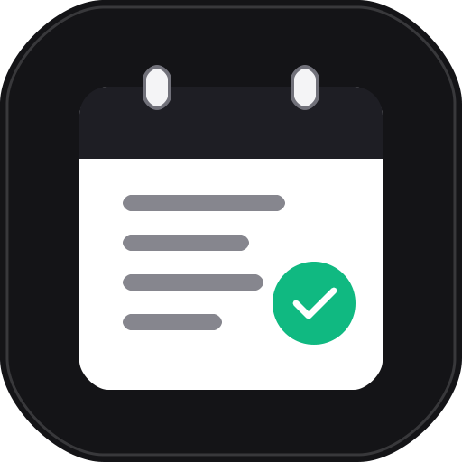

# ⚡ Blackboarder

<p align="center">
  
</p>

<p align="center">
  <strong>Deadline tracker and academic companion for Blackboard Learn</strong>
</p>

<p align="center">
  <a href="https://github.com/yvs1n/blackboarder/releases/latest"></a>
  <a href="https://github.com/yvs1n/blackboarder/releases/latest"></a>
  <a href="#-quick-start--installation"></a>
  <a href="#-phone-app-and-calendar"></a>
  <a href="#-development"></a>
  <a href="#-phone-app-and-calendar"></a>
  <a href="LICENSE"></a>
</p>

---

## 📖 What it is

Course announcements on Blackboard bury quiz dates, homework deadlines, exams and room changes inside long English or Arabic messages. **Blackboarder** reads them for you and turns them into one calendar of deadlines.

It is built for the **University of Sharjah** (`elearning.sharjah.ac.ae`, `blackboard.sharjah.ac.ae`) and works on standard Blackboard Learn and Ultra portals. It has three parts that stay in sync:

| Part | What it does |
| :--- | :--- |
| **Browser extension** | Scans Blackboard, finds deadlines, and shows them in a popup or the browser's side panel. |
| **Phone app (PWA)** | The same calendar and deadlines on your phone. Installs to the home screen and works offline. |
| **Calendar feed** | A live `.ics` link for Apple Calendar, Google Calendar or Outlook. |

Data syncs through **Firebase**, each student under their own private sync key. No account or sign-in is needed.

---

## 🌟 Features

- **Finds deadlines automatically.** A local parser reads English and Arabic keywords (*quiz*, *assignment*, *midterm*, *كويز*, *واجب*, *امتحان*) and dates such as `Oct 15`, `18/10/2026` or `next Sunday`. Optional AI steps handle vague or long announcements (see Settings and AI Keys below).
- **Monthly calendar and deadline list.** Monday-first grid, tasks sorted by time within each day, and a day view with the full announcement, room, grade weight and your notes.
- **Course schedule matching.** When an announcement does not name a room or time, Blackboarder fills it in from your weekly class schedule.
- **Grade weights.** Shows how much each deliverable counts (for example *Midterm 25%*) on cards and in the calendar. A percentage elsewhere in an announcement ("final exam out of 75%") is not taken as the weight.
- **Marks from the Blackboard gradebook.** Every scan reads your gradebook and puts each mark on its deadline. A **Marks** card lists them by course, newest first, with the share of the grade each one earned. A practice or mock exam never takes the real exam's mark, and each scan says how many marks matched.
- **Syllabus progress.** For each course, how much of the syllabus weight is done, pending, or not announced yet.
- **Add deadlines quickly.** The course field lists your courses and narrows as you type. Closing the popup while adding or editing a deadline, or in Settings, reopens right there.
- **Quick links.** One-tap links to marks, attendance, study plan, library and your own custom links, synced to the phone.
- **Private sync.** Every install gets its own sync key (`BBS-` plus 10 random characters). Changes on the laptop show up on the phone and the other way round.
- **Dark mode** for the extension, the phone app, and Blackboard itself.
- **Updates itself from GitHub**, the way a Chrome Web Store extension would (see [Automatic updates](#-automatic-updates)).

---

## 🚀 Quick Start & Installation

Works in **Chrome, Edge, Brave, Opera and Vivaldi**.

### 1. Get the files

- **GitHub Release (Recommended):** Download **[`blackboarder-extension.zip`](https://github.com/yvs1n/blackboarder/releases/latest)** from the latest release and unzip it somewhere permanent (for example `Documents\blackboarder`). Do not delete the folder afterwards; the browser loads the extension from it.
- **With git:** `git clone https://github.com/yvs1n/blackboarder.git` (loads from `dist/`).

You do not need to build anything; everything is precompiled.

### 2. Load the extension

1. Open your browser's extensions page: `chrome://extensions`, `edge://extensions` or `brave://extensions`.
2. Turn on **Developer mode** (top right).
3. Click **Load unpacked** and select the unzipped folder (or the **`dist`** folder if using git).
4. Pin **Blackboarder** to the toolbar.

### 3. Turn on automatic updates (once)

- **Windows:** double-click **`update.bat`** in the project folder.
- **macOS / Linux:** run `./update.sh` in the project folder.

This registers a small helper that lets the extension update itself whenever a new version is pushed to GitHub. Then go back to the extensions page and click the reload arrow on Blackboarder once. Your tasks, courses and sync key are kept.

### 4. Use it

1. Open Blackboard (for UOS: `https://elearning.sharjah.ac.ae/ultra/stream`).
2. Click the floating **Scan Blackboard** button, or press **Alt+B** (**Option+Shift+B** on Mac) to open the popup.
3. To keep Blackboarder open next to the page, open it in the browser's **side panel**.

---

## 📱 Phone App and Calendar

The phone app is at **`https://blackboarder.pages.dev/companion/`**. The site root, `blackboarder.pages.dev`, is the project's landing page.

1. In the extension, open **Settings** and click **Copy Phone Pairing Link**.
2. Open that link on your phone. The app pairs with your sync key and loads your deadlines.
3. Add it to your home screen: **Share > Add to Home Screen** on iPhone, or **Install app** in Chrome on Android.
4. To get deadlines in your calendar, click **Copy WebCal Feed Link** in Settings (or **Subscribe** in the phone app):
   - **Apple Calendar:** opening the `webcal://` link asks to subscribe.
   - **Google Calendar:** on a computer, go to **Other calendars > + > From URL** and paste the `https://.../feed.ics?key=...` link.

The calendar link includes your sync key. Links without a key are rejected, so if an old subscription stops updating, copy the link again and re-subscribe.

---

## ⚙️ Settings and AI Keys

No API key? The built-in parser reads announcements automatically, so everything works without one. A key only adds an AI model for long or vague announcements. Set the model and key in the **extension** (Settings > Scanning); the phone app uses the same one through your server and never holds the key.

| Setting | What it is for | Default |
| :--- | :--- | :--- |
| **AI provider** | OpenRouter, IFM K2 Horizon (free daily tokens from platform.ifm.ai), or any OpenAI-compatible API (base URL and model name). Each keeps its own key, and **Test connection** checks it | OpenRouter |
| **API key** | AI extraction for long or vague announcements | Empty (optional) |
| **AI model** | Model used through OpenRouter | `google/gemini-3.8-flash` |
| **Hosted Web Dashboard URL** | Your site address. The phone app is at `/companion/` and the calendar feed at `/feed.ics` | `https://blackboarder.pages.dev` |
| **Own Sync Server** | Only for a self-hosted server. Leave empty to sync through Firebase | Empty |
| **Auto-scan** | Scans announcements when a Blackboard page loads | On |
| **Theme** | Light, dark, or match the system | Match the system |

The two URL fields are under **Settings > Advanced Server & Endpoints**.

---

## 🌐 Hosting Your Own Copy

You only need this to run your own phone app and backend instead of `blackboarder.pages.dev`. Full steps are in the [hosting guide](docs/HOSTING_GUIDE.md).

1. **Cloudflare Pages (recommended).** Connect the GitHub repository in **Workers & Pages**, with no build command and **`mobile-web`** as the output folder. Every push to `main` then deploys automatically. `mobile-web/_worker.js` is the backend: sync API, calendar feed and the AI key locker. To let the phone app use your AI model, set an **`AI_KEY_SECRET`** environment variable (any long random text) in the Cloudflare project and publish the latest `database.rules.json`. See [docs/HOSTING_GUIDE.md](docs/HOSTING_GUIDE.md).
2. **Firebase.** Create a Realtime Database, then paste [`database.rules.json`](database.rules.json) into **Realtime Database > Rules** and click **Publish**. The rules only take effect once published. They allow each sync key to read and write only its own `users/<key>` folder. If you use your own database, change the URL in `src/utils/firebaseSync.ts`, `mobile-web/app.js` and `mobile-web/_worker.js`.
3. **Point the extension at it.** Set **Hosted Web Dashboard URL** in Settings to your Pages address.
4. **Optional:** add a Cloudflare rate limiting rule for `/api/*`. The built-in limit (60 requests a minute per IP and per key) slows abuse down but does not stop it.
5. **What gets served.** The one Pages project serves the landing page at `/` (`mobile-web/index.html`), the phone app at `/companion/` (`mobile-web/companion/`), and the API and calendar feed from `mobile-web/_worker.js`. Old pairing links (`/?key=...`) and phones that installed the app from the old address are sent on to `/companion/` automatically.

Other hosts: **Vercel** (deploy from the repository root; `api/[...path].js` runs the same backend) or a **local server** for your own Wi-Fi (`npm run server`).

---

## 🔄 Automatic Updates

Pushing to `main` updates everything without a store:

- **GitHub Actions** (`.github/workflows/build.yml`) builds, type-checks, lints and tests every push, then commits the generated files (`dist/`, `mobile-web/core.js`, the `version.json` files and the standalone worker).
- **Phone app:** Cloudflare Pages deploys the push. The app notices the new build and reloads into it when you open it or come back to it, never while you are typing.
- **Extension:** once `update.bat` / `update.sh` has run, the extension checks GitHub every 15 minutes. The helper downloads the new build into the extension folder, and the extension restarts once its popup and side panel are closed. **In a git clone** the helper runs `git pull --ff-only` instead, and only when the clone is on `main` with no uncommitted changes, so it never overwrites your work. Otherwise **Settings** shows why it skipped.

Each build is identified by a hash of its files, so a push that does not change the extension does not update it (the same goes for the phone app).

**Version sync.** The version in `package.json` is the only one to edit. `npm run build` copies it into the extension manifest, the phone app, the landing page and this README's badges, and `npm run lint` fails if any of them disagree. CI runs both on every push.

---

## 🧪 Development

```bash
npm install        # install dependencies
npm run build      # build dist/, mobile-web/companion/core.js and the workers; sync versions
npm run lint       # type-check plus style, JSON and version-sync checks
npm test           # run the Vitest suite
npm run package    # build release zips into release/
npm run server     # optional local server on http://localhost:3456
```

Run `npm run lint` and `npm test` before every commit. [`AGENTS.md`](AGENTS.md) lists what is where and the rules to follow; update it in the same commit as any change that makes it wrong.

### Which files to edit

The TypeScript in `src/` is the single source of course, deadline, weighting, sorting and calendar logic. The build bundles what the phone app needs into `mobile-web/companion/core.js`.

All three interfaces (extension, companion, landing page) follow one design system, described in [`docs/DESIGN_SYSTEM.md`](docs/DESIGN_SYSTEM.md): the two-tone colours (near-black and near-white, with grey shades between), Inter Tight and Inter, square corners, no gradients, and one solid primary action per screen.

- **Edit:** `src/`, `mobile-web/index.html` (landing page), `mobile-web/_worker.js` (backend), the hand-written files in `mobile-web/companion/` (`app.js`, `index.html`, `styles.css`, `sw.js`, `manifest.json`), `widgets/`, `updater/`, `public/`.
- **Never edit (generated):** `dist/`, `mobile-web/companion/core.js`, `mobile-web/companion/widget.js`, the `version.json` files, `src/buildInfo.ts`, `self-hosted/server/calendarFeed.js` and `self-hosted/cloudflare-worker/worker.js`. The build rewrites them and CI rebuilds them on every push.

---

## 📂 Project Structure

```text
blackboarder/
|-- src/                  Extension source (TypeScript)
|   |-- popup/            Popup and side panel
|   |-- content/          Scraper and dark mode for Blackboard pages
|   |-- background/       Background worker: sync, reminders, automatic updates
|   |-- engine/           Deadline detection: local parser, then an optional AI model
|   |-- core/             Logic shared with the phone app: courses, weights, schedules
|   |-- utils/            Storage, Firebase sync, calendar, task merging
|   `-- mobile/core.ts    Bundled into mobile-web/companion/core.js
|
|-- mobile-web/           The website, served as-is by Cloudflare Pages
|   |-- index.html        Landing page (/)
|   |-- companion/        Phone app (PWA) at /companion/
|   |-- sw.js             Retires the old root service worker
|   `-- _worker.js        Backend: sync API, calendar feed, AI key locker
|-- dist/                 Built extension; load this folder (generated)
|
|-- updater/              Update helper (copied into dist/ by the build)
|-- update.bat, update.sh Turn on automatic updates (run once)
|-- database.rules.json   Firebase security rules (publish in the Firebase console)
|
|-- api/                  Vercel entry point (runs mobile-web/_worker.js)
|-- self-hosted/          Standalone Cloudflare Worker and local Node server
|-- widgets/              iOS Scriptable widget source
|-- public/               Extension manifest template and icons
|-- scripts/              Build, lint and packaging scripts
|-- tests/                Automated tests
|-- docs/                 Install, hosting, walkthrough and design system guides
|
|-- CHANGELOG.md          Release notes
`-- AGENTS.md             Project map and rules for contributors and coding agents
```

**Folders that cannot move:** installed extensions read `dist/` and the `version.json` files to update themselves, Cloudflare Pages serves `mobile-web/`, and Vercel looks for functions in `api/`.

**Guides:** [Install the extension](docs/INSTALL_EXTENSION.md) | [Host the phone app](docs/HOSTING_GUIDE.md) | [How it all works](docs/WALKTHROUGH.md)

---

## 📄 License

Built by [Yassin Ragab](https://yassinr.me), a freshman at the University of Sharjah.

This project is licensed under the [MIT License](LICENSE). Copyright (c) 2026 Yassin Ragab.
